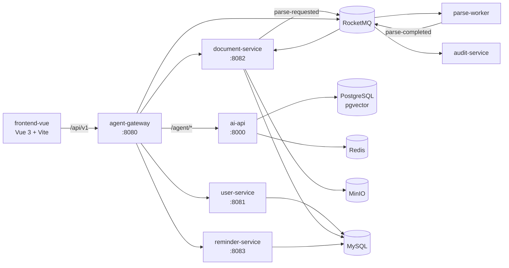

<div align="center">

# DocQA · 智能学习助手

**上传课件与文档，异步解析并建立向量索引，用 RAG 回答基于文档内容的问题。**

同时支持课表导入、作业截止提醒与自定义提醒，面向大学生的本地智能学习工作台。

[](https://github.com/ybw0405-study/DocQA/actions/workflows/ci.yml)
[](LICENSE)
[](https://github.com/ybw0405-study/DocQA/releases)
[](https://openjdk.org/projects/jdk/17/)
[](https://www.python.org/)
[](https://nodejs.org/)
[](https://vuejs.org/)
[](CONTRIBUTING.md)

</div>

---

## 目录

- [为什么是 DocQA](#为什么是-docqa)
- [功能特性](#功能特性)
- [架构](#架构)
- [技术栈](#技术栈)
- [目录结构](#目录结构)
- [快速开始](#快速开始)
- [文档](#文档)
- [参与贡献](#参与贡献)
- [安全](#安全)
- [许可证](#许可证)

## 为什么是 DocQA

- **答案有出处**：回答附带引用溯源，能定位到具体文档与片段，而不是凭空生成。
- **控制面 / 数据面分离**：Java 负责认证、路由、治理与业务状态；Python 负责解析、向量化与 RAG。AI 依赖被收敛到唯一入口，预算、配额、熔断与审计可治理。
- **本地优先**：中间件、模型适配与数据都在本机或自己的服务器上，课件不必上传到第三方。
- **工程化完整**：三端统一门禁、数据库最小权限、审计只追加、架构约束与契约测试。

## 功能特性

| 能力 | 说明 |
|---|---|
| 文档智能问答 | PDF / Word / 文本上传，后台异步解析、分块、向量化；RAG 问答支持同步与 SSE 流式，回答附带引用溯源 |
| 认证与 RBAC | JWT 无状态认证、刷新令牌轮换、USER / ADMIN 角色 |
| 文档管理 | 分片上传、MD5 秒传、重命名、标签、软删除、失败重试、重建索引 |
| 课表与提醒 | ICS 日历导入、作业截止提醒、自定义提醒、站内通知 |
| 治理与可观测 | AI 调用开关、按用户配额、审计事件、用量统计、Prometheus 指标 |

## 架构

项目采用**控制面 / 数据面分离**的微服务架构：前端只访问 Java 网关，Java 只通过 `agent-gateway` 调用 Python，文档解析链路走异步消息。



各服务职责、依赖方向与目录说明见 [docs/00-infra/maven-modules.md](docs/00-infra/maven-modules.md)。

## 技术栈

| 端 | 技术 |
|---|---|
| 后端（Java 17） | Spring Boot 3.3、Spring Cloud Gateway、Spring Security、MyBatis / JDBC、Flyway |
| 数据面（Python ≥3.11） | FastAPI、LangChain/LangGraph、Pydantic v2、psycopg3、OpenTelemetry |
| 前端 | Vue 3.5、TypeScript 5.9、Vite、Pinia（无 UI 组件库，样式自持） |
| 存储与中间件 | MySQL 8、PostgreSQL 16 + pgvector、Redis、RocketMQ 5、MinIO |

## 目录结构

```text
DocQA/
├── .github/             # CI、Issue/PR 模板、CODEOWNERS、Dependabot
├── backend-java/        # Java 控制面（Maven 多模块）
│   ├── common/          #   公共模型、指标、架构约束
│   ├── mq-support/      #   RocketMQ 管理采集适配层
│   ├── user-service/    #   认证与用户（8081）
│   ├── document-service/#   文档上传·解析·索引（8082）
│   ├── agent-gateway/   #   统一网关与 AI 治理（8080）
│   ├── reminder-service/#   提醒与通知（8083）
│   └── audit-service/   #   审计（纯 MQ 消费者）
├── ai-python/           # Python 数据面（FastAPI）
│   └── src/docqa_ai/
│       ├── api/         #   REST 入口
│       ├── agent/       #   Agent 编排与 RAG
│       ├── parse_worker/#   解析 / 向量 worker
│       ├── governance/  #   配额、预算、审计
│       └── providers/   #   LLM / Embedding / Rerank 适配
├── frontend-vue/        # 前端（Vue 3 + Vite）
├── docs/                # 需求、设计、运维文档（索引见 docs/README.md）
├── ops/                 # 数据库最小权限与运维脚本
├── scripts/             # 一键验证脚本
├── CONTRIBUTING.md      # 贡献指南
├── CODE_OF_CONDUCT.md   # 行为准则
├── SECURITY.md          # 安全策略
├── CHANGELOG.md         # 变更日志
├── SUPPORT.md           # 技术支持
└── LICENSE              # Apache-2.0
```

## 快速开始

### 前置依赖

| 依赖 | 版本 |
|---|---|
| JDK | 17 |
| Maven | 3.9+（父 POM 的 enforcer 拒绝 3.8） |
| Node.js | ≥ 22.22.2（jsdom 30 与 Vite 8 的下限） |
| Python | ≥ 3.11（建议 3.13） |
| 中间件 | MySQL 8、PostgreSQL 16 + pgvector、Redis、RocketMQ 5、MinIO |
| 虚拟化 | WSL2（解析 worker 的 RocketMQ 客户端仅提供 Linux 绑定） |

```bash
git clone https://github.com/ybw0405-study/DocQA.git
cd DocQA
```

### 一键验证

```bash
./scripts/verify-all.sh --offline                 # Git Bash / Linux / CI
powershell -File scripts/verify-all.ps1 -Offline  # Windows PowerShell 5.1
```

脚本按序执行 Java `mvn clean verify`、Python `pytest + ruff`、前端
`typecheck + lint + test + build`，任一失败即非零退出。

### 本地启动

完整顺序、端口与环境变量清单见 [docs/00-infra/getting-started.md](docs/00-infra/getting-started.md)。
以下脚本全部按自身位置推导仓库根，**没有 `<repo>` 占位符，目录改名后也不用改命令**。

首次准备，在 WSL root 终端且当前目录为仓库根时执行：

```bash
REPO="$(pwd)"
bash "$REPO/docs/00-infra/prepare-local-stack.sh"           # 中间件
bash "$REPO/docs/00-infra/setup-parse-worker.sh" install    # venv + C 绑定
bash "$REPO/docs/00-infra/install-wsl-autostart.sh" install # 注册 WSL 开机自启
```

日常使用，在仓库根目录开一个 PowerShell：

```powershell
# 推荐：注册登录自启（当前用户，无需管理员），之后开机自动完成全部拉起
powershell -ExecutionPolicy Bypass -File .\docs\00-infra\start-local.ps1 -InstallAutostart -IncludeApp

# 或：立即启动一次 —— 同步 WSL IP 并拉起中间件、worker、Java、Python API、前端
powershell -ExecutionPolicy Bypass -File .\docs\00-infra\start-local.ps1 -IncludeApp

# 若 8080/8081 被其它程序占用，整体平移端口
powershell -ExecutionPolicy Bypass -File .\docs\00-infra\start-local.ps1 -IncludeApp -PortOffset 10000
```

只启动中间件与 worker（不启应用层）：去掉 `-IncludeApp` 即可；
分步手动启动见 [getting-started.md](docs/00-infra/getting-started.md)。

### 环境变量

所有连接串与凭据均通过 `DOCQA_*` 环境变量注入，仓库内不含任何真实凭据。
变量清单见 [getting-started.md](docs/00-infra/getting-started.md#环境变量)。

## 文档

| 文档 | 内容 |
|---|---|
| [docs/README.md](docs/README.md) | 文档总索引 |
| [getting-started.md](docs/00-infra/getting-started.md) | 本地启动、端口、环境变量、故障排查 |
| [maven-modules.md](docs/00-infra/maven-modules.md) | Java 模块职责与依赖边界 |
| [archunit-rules.md](docs/00-infra/archunit-rules.md) | 架构约束与 ArchUnit 规则 |
| [git-workflow.md](docs/00-infra/git-workflow.md) | 分支模型、提交规范、PR 检查项 |
| [storage.md](docs/02-design/storage.md) | 表结构、索引与向量存储 |
| [openapi-java.yaml](docs/02-design/openapi-java.yaml) | Java 对外接口契约 |
| [cross-language-protocol.md](docs/02-design/cross-language-protocol.md) | Java ↔ Python 治理协议 |

## 参与贡献

欢迎提交 Issue 与 Pull Request。开始之前请阅读：

- [CONTRIBUTING.md](CONTRIBUTING.md)：开发环境、分支与提交规范、PR 清单
- [CODE_OF_CONDUCT.md](CODE_OF_CONDUCT.md)：社区行为准则
- [SUPPORT.md](SUPPORT.md)：提问渠道与信息准备

## 安全

请勿在公开 Issue 中披露安全漏洞，报告流程见 [SECURITY.md](SECURITY.md)。

## 许可证

[Apache License 2.0](LICENSE) © 2026 YYYBBW
