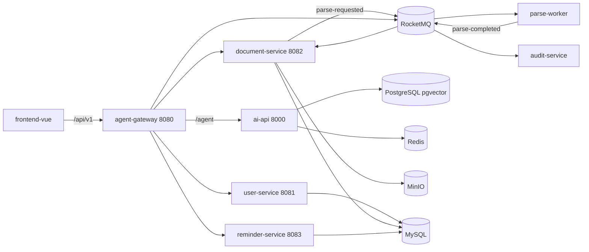

<div align="center">

# DocQA · 智能学习助手

**上传课件与文档，异步解析并建立向量索引，用 RAG 回答基于文档内容的问题。**

同时支持课表导入、作业截止提醒与自定义提醒，面向大学生的本地智能学习工作台。

[](https://github.com/ybw0405-study/DocQA/actions/workflows/ci.yml)
[](LICENSE)
[](https://github.com/ybw0405-study/DocQA/releases)
[](https://openjdk.org/projects/jdk/17/)
[](https://www.python.org/)
[](https://nodejs.org/)
[](https://vuejs.org/)
[](CONTRIBUTING.md)

</div>

---

## 目录

- [为什么是 DocQA](#为什么是-docqa)
- [功能特性](#功能特性)
- [架构](#架构)
- [技术栈](#技术栈)
- [目录结构](#目录结构)
- [快速开始](#快速开始)
- [文档](#文档)
- [参与贡献](#参与贡献)
- [安全](#安全)
- [许可证](#许可证)

> ## ⚠️ 关于「智能问答」的真实状态（必读）
>
> 本项目的 RAG **工程架构是完整真实的**（异步解析 → 分块 → 向量索引 → 混合检索 → 引用溯源），
> 但**开箱默认运行在 `offline` 占位模式**，并非真实语义检索：
>
> | 组件 | 默认 provider | 默认行为 |
> |---|---|---|
> | 向量化 | `offline`（`offline-hashing-1024`） | 特征哈希，**非语义向量** |
> | 问答生成 | `offline`（`offline-extractive`） | 抽取原文片段，**非生成式** |
> | 重排 | `offline`（`noop`） | **不做重排** |
>
> 因此**默认配置下「检索质量数字不存在」**——命中率、精度、`LOW_CONFIDENCE` 误判率都尚未被测过，
> 真实 embedding / LLM / rerank **一次也未发出过请求**。
>
> 要获得真实的语义检索 + 生成式回答，需把 `DOCQA_EMBEDDING_PROVIDER` / `DOCQA_LLM_PROVIDER` /
> `DOCQA_RERANK_PROVIDER` 切到真实 provider（`openai` / `dashscope`）并配置 `DOCQA_EXPERIMENT_BUDGET > 0`
> （详见 [`docs/02-design/cross-language-protocol.md`](docs/02-design/cross-language-protocol.md) 的 S6 里程碑）。
> 这不是缺陷，而是当前**明确未完成的边界**，请勿把「CI 全绿」误读为「已具备语义问答能力」。

## 为什么是 DocQA

- **答案有出处**：回答附带引用溯源，能定位到具体文档与片段，而不是凭空生成。
- **控制面 / 数据面分离**：Java 负责认证、路由、治理与业务状态；Python 负责解析、向量化与 RAG。AI 依赖被收敛到唯一入口，预算、配额、熔断与审计可治理。
- **本地优先**：中间件、模型适配与数据都在本机或自己的服务器上，课件不必上传到第三方。
- **工程化完整**：三端统一门禁、数据库最小权限、审计只追加、架构约束与契约测试。
- **租户隔离地基**：Java 控制面的业务表、JWT 租户声明、文档授权范围与租户级治理开关全链路强过滤；
  pgvector 块表带 `tenant_id` 列，并在向量 / 词法检索谓词中强制过滤作为纵深防御（**授权判定仍在 Java 网关**）。
  当前默认单租户运行，第二租户由运维 bootstrap 端点供给（见下方设计文档）。

## 功能特性

| 能力 | 说明 |
|---|---|
| 文档智能问答 | PDF / Word / 文本上传，后台异步解析、分块、向量化；RAG 问答支持同步与 SSE 流式，回答附带引用溯源 |
| 认证与 RBAC | JWT 无状态认证、刷新令牌轮换、USER / ADMIN 角色 |
| 文档管理 | 分片上传、MD5 秒传、重命名、标签、软删除、失败重试、重建索引 |
| 课表与提醒 | ICS 日历导入、作业截止提醒、自定义提醒、站内通知 |
| 治理与可观测 | AI 调用开关、按用户配额、审计事件、用量统计、Prometheus 指标 |

> **已知取舍**：RAG 回答正文按纯文本插值渲染、不解析 markdown（零 XSS 面，代价是 `**加粗**` 等标记原样显示）。若将来引入富文本渲染，必须同步 `frontend-vue/tests/redlines.spec.ts` 的注入白名单并配 DOMPurify。

## 架构

项目采用**控制面 / 数据面分离**的微服务架构：前端只访问 Java 网关，Java 只通过 `agent-gateway` 调用 Python，文档解析链路走异步消息。



各服务职责、依赖方向与目录说明见 [docs/00-infra/maven-modules.md](docs/00-infra/maven-modules.md)。

### 部署网络边界（必读）

Python 数据面 `ai-api` 的端口**不得对公网或不可信网络可达**：该端口接收的 `tenantId` / `userId` /
`documentScopes` 由调用方给出，身份结论以 Java 网关为准。生产部署必须同时满足：

1. 网关与 Python 之间配置共享密钥 `DOCQA_AI_INTERNAL_TOKEN`（`X-Internal-Token` 头，常量时间比较）；
   未配置时为本地开发模式、不启用校验，**生产环境留空会启动 fail-fast**。
2. 网络层只允许 `agent-gateway` 访问 Python 端口（容器网络 / 安全组 / 防火墙），`/metrics` 同样不对外。
3. Java 业务服务端口（8081~8083）与 MySQL / PostgreSQL / Redis / MinIO / RocketMQ 同样仅限内网。
4. JWT 为 HS256 对称密钥：签发能力应只保留在 `user-service`，其余服务仅验签；密钥泄露等于可伪造任意
   ADMIN，必须经密钥管理注入并定期轮换。

隔离是「网关授权 + 数据面纵深过滤 + 网络边界」三层，任何一层单独都不构成「全链路隔离」的承诺。

5. 六个 Java 服务共享同一个 MySQL schema（`agent-gateway` 直接读写 `conversation` / `message` /
   `agent_execution` / `document` / `audit_event` 表），这是有意的「单体库多服务」取舍；
   表结构演进必须同时核对全部引用方（V9 / V10 的复合键改造即按此执行），不要假设服务间有库级隔离。
6. `ai-python` 用 LangGraph 搭的是两节点线性循环（`plan → tool / END`），保留它是为后续扩展工具链，
   代价是需要持续跟踪 `langgraph` / `langchain-core` / `langsmith` 的安全基线；这是已知依赖取舍，不是架构缺口。


## 技术栈

| 端 | 技术 |
|---|---|
| 后端（Java 17） | Spring Boot 3.3、Spring Cloud Gateway、Spring Security、MyBatis / JDBC、Flyway |
| 数据面（Python ≥3.11） | FastAPI、LangChain/LangGraph、Pydantic v2、psycopg3、OpenTelemetry |
| 前端 | Vue 3.5、TypeScript 5.9、Vite、Pinia（无 UI 组件库，样式自持） |
| 存储与中间件 | MySQL 8、PostgreSQL 16 + pgvector、Redis、RocketMQ 5、MinIO |

## 目录结构

```text
DocQA/
├── .github/             # CI、Issue/PR 模板、CODEOWNERS、Dependabot
├── backend-java/        # Java 控制面（Maven 多模块）
│   ├── common/          #   公共模型、指标、架构约束
│   ├── mq-support/      #   RocketMQ 管理采集适配层
│   ├── user-service/    #   认证与用户（8081）
│   ├── document-service/#   文档上传·解析·索引（8082）
│   ├── agent-gateway/   #   统一网关与 AI 治理（8080）
│   ├── reminder-service/#   提醒与通知（8083）
│   └── audit-service/   #   审计（纯 MQ 消费者）
├── ai-python/           # Python 数据面（FastAPI）
│   └── src/docqa_ai/
│       ├── api/         #   REST 入口
│       ├── agent/       #   Agent 编排与 RAG
│       ├── parse_worker/#   解析 / 向量 worker
│       ├── governance/  #   配额、预算、审计
│       └── providers/   #   LLM / Embedding / Rerank 适配
├── frontend-vue/        # 前端（Vue 3 + Vite）
├── docs/                # 需求、设计、运维文档（索引见 docs/README.md）
├── ops/                 # 数据库最小权限与运维脚本
├── scripts/             # 一键验证脚本
├── CONTRIBUTING.md      # 贡献指南
├── CODE_OF_CONDUCT.md   # 行为准则
├── SECURITY.md          # 安全策略
├── CHANGELOG.md         # 变更日志
├── SUPPORT.md           # 技术支持
└── LICENSE              # Apache-2.0
```

## 快速开始

### 前置依赖

| 依赖 | 版本 |
|---|---|
| JDK | 17 |
| Maven | 3.9+（父 POM 的 enforcer 拒绝 3.8） |
| Node.js | ≥ 22.22.2（jsdom 30 与 Vite 8 的下限） |
| Python | ≥ 3.11（建议 3.13） |
| 中间件 | MySQL 8、PostgreSQL 16 + pgvector、Redis、RocketMQ 5、MinIO |
| 虚拟化 | WSL2（解析 worker 的 RocketMQ 客户端仅提供 Linux 绑定） |

```bash
git clone https://github.com/ybw0405-study/DocQA.git
cd DocQA
```

### 一键验证

```bash
./scripts/verify-all.sh --offline                 # Git Bash / Linux / CI
powershell -File scripts/verify-all.ps1 -Offline  # Windows PowerShell 5.1
```

脚本按序执行 Java `mvn clean verify`、Python `pytest + ruff`、前端
`typecheck + lint + test + build`，任一失败即非零退出。

### 本地启动

完整顺序、端口与环境变量清单见 [docs/00-infra/getting-started.md](docs/00-infra/getting-started.md)。
以下脚本全部按自身位置推导仓库根，**没有 `<repo>` 占位符，目录改名后也不用改命令**。

前置：安装并启动 **Docker Desktop**（`docker info` 可正常返回）。在仓库根目录开一个 PowerShell：

```powershell
# 仅首次：从模板生成本机配置（gitignored，不写全局环境变量）
Copy-Item ops/env/local.env.example ops/env/local.env   # 按需填写口令

.\scripts\start-dev.ps1          # compose up → 等健康 → 幂等授权 → 构建 → 起全部服务
.\scripts\stop-dev.ps1           # 只停应用进程
.\scripts\stop-dev.ps1 -Infra    # 连容器一起停（卷保留，数据不丢）
```

常用选项：`-NoBuild` 跳过构建（jar 已最新时）、`-InfraOnly` 只起中间件、`-SkipGrants` 跳过授权重放。
分步手动启动与故障排查见 [getting-started.md](docs/00-infra/getting-started.md)。

> 历史方案（WSL 中间件 + 开机自启，`docs/00-infra/` 下的 `prepare-local-stack.sh` /
> `start-local.ps1` 等）已退役，仅保留作回滚参考，见 getting-started.md 后半部分。

### 环境变量

所有连接串与凭据的唯一事实来源是 `ops/env/local.env`（gitignored，模板见
`ops/env/local.env.example`），由 `start-dev.ps1` 注入**进程作用域**，不写 Windows
全局环境变量；仓库内不含任何真实凭据。变量清单见
[getting-started.md](docs/00-infra/getting-started.md#环境变量)。

## 文档

| 文档 | 内容 |
|---|---|
| [docs/README.md](docs/README.md) | 文档总索引 |
| [getting-started.md](docs/00-infra/getting-started.md) | 本地启动、端口、环境变量、故障排查 |
| [maven-modules.md](docs/00-infra/maven-modules.md) | Java 模块职责与依赖边界 |
| [archunit-rules.md](docs/00-infra/archunit-rules.md) | 架构约束与 ArchUnit 规则 |
| [git-workflow.md](docs/00-infra/git-workflow.md) | 分支模型、提交规范、PR 检查项 |
| [rollback-runbook.md](docs/00-infra/rollback-runbook.md) | 版本回退、迁移兼容性与向量索引回退预案 |
| [storage.md](docs/02-design/storage.md) | 表结构、索引与向量存储 |
| [openapi-java.yaml](docs/02-design/openapi-java.yaml) | Java 对外接口契约（当前 2.6.0） |
| [cross-language-protocol.md](docs/02-design/cross-language-protocol.md) | Java ↔ Python 治理协议 |
| [saas-kernel-upgrade.md](docs/02-design/saas-kernel-upgrade.md) | SaaS 内核升级方案与 P1-B 落地记录 |
| [saas-tenant-decisions.md](docs/02-design/saas-tenant-decisions.md) | 多租户遗留决策清单（D1～D6） |

### 版本号说明

**产品版本**（当前 `2.1.0`，三端 `pom.xml` / `package.json` / `pyproject.toml` 与 Release tag `v2.1.0`）
与 **OpenAPI 契约版本**（`docs/02-design/openapi-java.yaml` 当前 `2.6.0`）是**两条独立的编号线**：
前者遵循语义化版本描述整个产品发布，后者只描述 Java 对外接口的契约演进，契约文件头部
`2.0.0` 指的是它自己的一次历史身份模型改造，与产品版本号无关。改动接口时升契约版本，
发版时升产品版本，两者不要求同步。

## 参与贡献

欢迎提交 Issue 与 Pull Request。开始之前请阅读：

- [CONTRIBUTING.md](CONTRIBUTING.md)：开发环境、分支与提交规范、PR 清单
- [CODE_OF_CONDUCT.md](CODE_OF_CONDUCT.md)：社区行为准则
- [SUPPORT.md](SUPPORT.md)：提问渠道与信息准备

## 安全

请勿在公开 Issue 中披露安全漏洞，报告流程见 [SECURITY.md](SECURITY.md)。

## 许可证

[Apache License 2.0](LICENSE) © 2026 ybw0405-study
