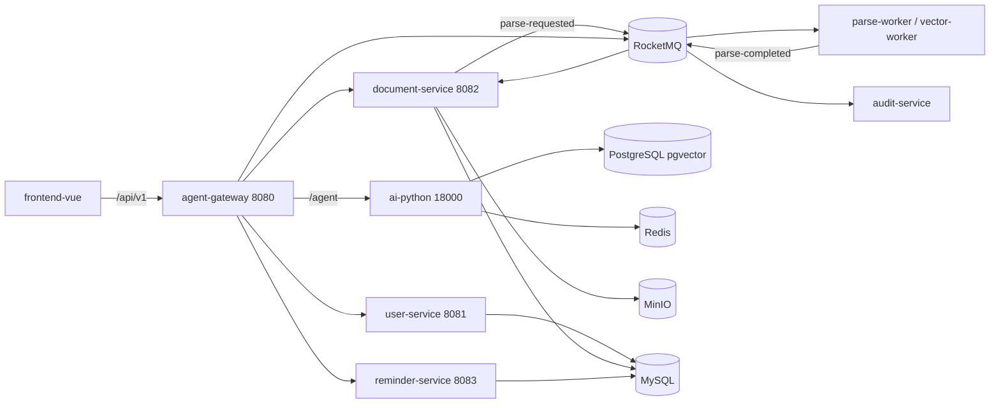

<div align="center">

# DocQA · 文档 RAG Agent 平台

**上传课件与文档，异步解析并建立向量索引，用带引用溯源的 RAG Agent 回答基于文档内容的问题。**

[](https://github.com/ybw0405-study/DocQA/actions/workflows/ci.yml)
[](https://github.com/ybw0405-study/DocQA/actions/workflows/eval-nightly.yml)
[](LICENSE)
[](https://openjdk.org/projects/jdk/17/)
[](https://www.python.org/)
[](https://vuejs.org/)

</div>

LangGraph 决策循环 + pgvector 混合检索（向量 + 词法）+ rerank + 引用溯源；MCP 工具接入带
白名单 / 掩码 / 预算 / 限流 / 审计治理；控制面（Java）与数据面（Python）分离，租户隔离全链路强过滤。
工具调用协议支持 json / native tool_calls 双通道（`DOCQA_AI_TOOL_PROTOCOL`，默认 json）。
附带课表导入与提醒等学习工作台功能（见[产品指南](docs/product-guide.md)）。

## 真实模型评测（2026-11-25，DashScope，跨文档）

| 指标 | 数值 | 口径 |
|---|---|---|
| recall@1 | 0.929 | **自建 21 题标注集 + 2 份跨文档干扰文档 + 3 条负例**，`text-embedding-v3` + `gte-rerank-v2`；样本小，不代表泛化能力 |
| recall@3 / @5 | 1.0 / 1.0 | 同上 |
| MRR / nDCG@5 | 0.976 / 0.979 | 同上；跨文档 hard negative 下 `labor-q2`「经济补偿」被干扰块挤下 R@1（正确块落 top2） |
| faithfulness 均分 | 1.0（门禁 ≥ 0.8） | LLM judge，生成 + 引用核对（nightly 真模型） |
| recall@1（离线基线） | 0.786 | 特征哈希向量（`eval/baselines/retrieval.json`），与语义检索不同空间，仅作链路回归基线 |

复现：`python -m docqa_ai.eval --suite all`（真实 provider 环境变量见下）；
2026-11-25 本地真实复现与 nightly 同口径一致。
**数据集仍是内置标注集、样本量不足以证明泛化能力**；评测已覆盖跨文档召回（候选池混入
干扰文档）与「文档无答案」负例（3 条，观察误召回率与 top_score 分布）。真实 PDF 课件
黄金集（30~50 条）扩充中，offline/real 对照表见
[docs/02-design/retrieval-eval.md](docs/02-design/retrieval-eval.md)。

> **开箱默认离线**：`offline` provider 为特征哈希向量 + 抽取式回答 + noop rerank，
> 零外呼、零成本，但**不是语义检索**。切真需设 `DOCQA_AI_EMBEDDING_PROVIDER` /
> `DOCQA_AI_LLM_PROVIDER` / `DOCQA_AI_RERANK_PROVIDER`（前缀是 `DOCQA_AI_`）并配
> `DOCQA_AI_EXPERIMENT_BUDGET > 0`，键集合见 [`ops/env/local.env.example`](ops/env/local.env.example)；
> 切真后对已有文档**重建索引**（哈希向量与语义向量不在同一空间）。
> 三套变量面（服务 `DOCQA_AI_*` / 评测 `DOCQA_EVAL_*` + 无前缀 / nightly secrets）不要混用。

## 架构



前端只访问 Java 网关；Java 只经 `agent-gateway` 调用 Python；解析链路走异步消息。
**Python 数据面端口不得对不可信网络可达**：身份结论以网关为准，生产必须配
`DOCQA_AI_INTERNAL_TOKEN` 并通过网络层收敛可达面（详见[产品指南](docs/product-guide.md)部署边界节）。

## 快速开始

前置：Docker Desktop（`docker info` 可用）；开发模式另需 JDK 17、Node 22、Python 3.12。

```powershell
# 仅首次：生成项目内配置（gitignored）
Copy-Item ops/env/local.env.example ops/env/local.env

# 全容器一条命令（中间件 + 6 服务 + 解析/向量 worker + 前端）
.\scripts\start-dev.ps1 -Containers
# 网关 http://127.0.0.1:18080 / 前端 http://127.0.0.1:18090

# 开发模式（宿主机进程；worker 仍需容器承载）
.\scripts\start-dev.ps1
docker compose -f ops/docker-compose.infra.yml -f ops/docker-compose.app.yml up -d parse-worker vector-worker
```

> ⚠️ **Windows 开发机注意**：解析 / 向量 worker 依赖 librocketmq 的 Linux C 绑定，无法在 Windows 宿主机运行。
> 请使用 `-Containers` 模式（worker 容器化）跑通「上传 → 解析 → 向量 → 检索」全链路；否则文档向量不写入，检索命中恒为 0。

首次登录：全新库默认无账号（安全默认）。种子演示账号或自助注册二选一，
开关与 BCrypt 摘要要求见 [getting-started](docs/00-infra/getting-started.md)。
管理页「模型」可在界面换模型（凭据 AES-256-GCM 密文落库、不回显、无需重启）。

## 核心能力

| 能力 | 说明 |
|---|---|
| 文档 RAG 问答 | PDF / Word / 文本异步解析 → 分块 → 向量索引 → 混合检索 → rerank → 带引用回答；同步 + SSE 流式 |
| Agent 工具链 | LangGraph plan/tool 循环 + Postgres checkpoint 断点续跑；json / native tool_calls 双通道；高风险工具 interrupt 人在回路审批；MCP（HTTP/stdio）与内置工具统一治理 |
| 治理 | 每用户配额与工具限流（fail-closed）、预算账本、Kill Switch、PII 掩码前置、提示注入围栏 |
| 租户隔离 | JWT 租户声明 + 业务表强过滤 + pgvector 谓词纵深防御；跨租户 404 |
| 认证与 RBAC | JWT + refresh 轮换、USER / ADMIN、注册白名单与限流 |
| 文档管理 | 分片上传、MD5 秒传、标签、软删除、失败重试、重建索引 |
| 长期记忆 | 显式指令写入（默认关）、按用户命名空间、TTL 与上限、注入为不可信参考 |
| 可观测 | Prometheus 指标、OTel + LangFuse v3 自托管（可选 profile）、审计只追加 + 追踪外链 |
| 学习工作台 | ICS 课表导入、作业截止提醒、自定义提醒、站内通知 |

## 技术栈

Spring Boot 3.3 多模块 + Spring Cloud Gateway MVC / FastAPI + LangGraph 1.x（checkpoint-postgres）/
pgvector 混合检索 / DashScope 与 OpenAI 兼容 provider / MCP SDK / RocketMQ / MySQL + Flyway /
Redis / MinIO / Vue 3 + Pinia + TypeScript / OpenTelemetry + Prometheus + LangFuse /
Docker 多阶段 + GHCR / GitHub Actions 三端门禁 + 真库契约测试。

## 已知限制与取舍

- **扫描件 / 图片型 PDF 暂不支持**：解析器覆盖文本型 PDF / Word / PPTX / TXT，无 OCR 引擎，扫描件需先经 OCR 转文本再导入。
- **分片上传支持并发分片合并，暂不支持断点续传**（断网重连需重新开始）。
- 默认离线占位、LangGraph 两节点循环的依赖取舍、RAG 正文纯文本渲染（零 XSS 面）等逐条说明见
[产品指南](docs/product-guide.md)与 [docs/02-design/](docs/02-design/)。
迁移注释中的历史阶段代号见 [索引](docs/02-design/migration-comment-codes.md)。

## 文档

- [本地启动指南](docs/00-infra/getting-started.md) / [产品与界面完整指南](docs/product-guide.md)
- [跨语言契约](docs/02-design/cross-language-protocol.md) / [检索评测](docs/02-design/retrieval-eval.md)
- [贡献指南](CONTRIBUTING.md) / [安全策略](SECURITY.md) / [变更日志](CHANGELOG.md)

## 许可证

[Apache-2.0](LICENSE)
