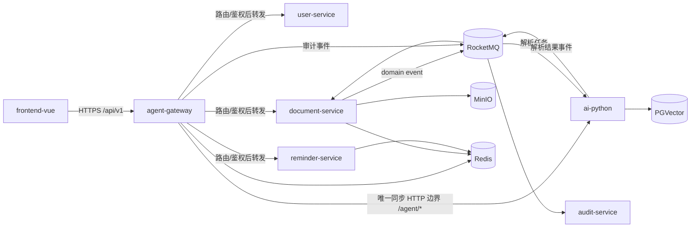

# Maven 多模块结构与依赖边界

## 1. 目标

本文固定 `backend-java` 的 Maven 模块划分、每个模块的职责，以及允许的依赖方向。后续编码阶段如果出现"为了省事直接依赖另一个服务"或"在业务模块里临时调一下 Python"的情况，以本文为唯一裁决依据。

父工程坐标：`com.docqa:docqa:2.1.0`，打包方式为 `pom`。统一使用 Java 17、Maven 3.9+、Spring Boot 3.3.x 与 Spring Cloud 2023.0.x。

## 2. 工程结构

```text
backend-java/
├── pom.xml                         # 父 POM：版本、插件、Checkstyle、Surefire、ArchUnit
├── common/                         # 通用契约与横切能力
│   └── pom.xml
├── mq-support/                     # RocketMQ admin 采集适配（把 broker 探针隔离出 common）
│   └── pom.xml
├── user-service/                   # 身份与 JWT
│   └── pom.xml
├── document-service/               # 文档上传、秒传、状态机、解析任务投递
│   └── pom.xml
├── agent-gateway/                  # 边缘网关 + Python 调用适配 + 会话控制面
│   └── pom.xml
├── reminder-service/               # 提醒与 RRULE 调度
│   └── pom.xml
└── audit-service/                  # 追加写审计
    └── pom.xml
```

Java 基础包统一为 `com.docqa.<module>`，例如 `com.docqa.document`、`com.docqa.agentgateway`。模块内部固定分层：`controller`、`service`、`manager`、`repository`、`domain`、`dto`、`config`、`infra`。

## 3. 模块职责与禁止事项

| 模块 | 核心职责 | 允许的 Maven 依赖 | 绝对不放进这个模块的东西 |
|---|---|---|---|
| `common` | 统一响应结构、错误码注册表、RFC 9457 `ProblemDetail` 映射、全局异常处理约定、traceId 上下文、通用 DTO/工具 | 仅通用技术库（Spring Web、Validation、Jackson、SLF4J）；不依赖任何业务模块 | 用户/文档/提醒业务逻辑；数据库、Redis、MQ、对象存储访问；对 Python 的 HTTP 客户端 |
| `mq-support` | RocketMQ admin 客户端与 broker 探针的隔离层：为 `MqConsumerLagProbe` 提供 admin API 适配，避免 `common` 直接引入 `org.apache.rocketmq..` | `common`、RocketMQ 客户端（`rocketmq-tools`） | 任何业务逻辑；不要被 `user-service` / `agent-gateway` / `audit-service` 引入（它们只用普通 client，不需要 admin 探针） |
| `user-service` | 用户注册登录、密码哈希、JWT 签发与校验、用户身份查询 | `common` | 文档解析、RAG、问答、提醒调度；调用 Python；其他服务的内部实现 |
| `document-service` | 分片上传会话、MinIO 对象落盘、MD5 秒传、文档元数据、`document` 状态机、RocketMQ 解析任务投递、状态查询 | `common`；MinIO、RocketMQ、数据库客户端 | 文档切分、Embedding、PGVector 检索、LLM 调用；用户密码或用户表写入；同步调用 Python |
| `agent-gateway` | Spring Cloud Gateway 路由、入口鉴权与限流、问答 API、`conversation`/`message` 控制面元数据、`agent_execution` 记录、治理参数组装、审计事件投递、超时/熔断/降级 | `common`；Spring Cloud Gateway、WebFlux/WebClient、Resilience4j、数据库客户端 | RAG 检索、Prompt 编排、LangGraph、LLM SDK、向量库查询、用户业务写入 |
| `reminder-service` | 提醒 CRUD、RRULE 解析与展开、课表导入、到点扫描、延时消息投递、重复提醒单行表达 | `common`；数据库、RocketMQ、Redis | 向用户发送消息的具体通道实现；RAG/LLM；用户表写入；调用 Python |
| `audit-service` | 消费审计事件、`audit_event` 追加写、审计查询与合规导出 | `common`；RocketMQ、数据库、只读查询组件 | UPDATE/DELETE 审计数据；业务决策与重试编排；RAG/LLM；调用 Python |

### 3.1 关键所有权说明

- `agent-gateway` 同时承担边缘网关和 Python 适配器两个角色，但它是**控制面组件**：只保存会话/消息/执行记录等控制面元数据，不保存向量，也不实现检索算法。
- `document-service` 只发布"文档需要解析"的领域事件，不关心消费者是 Python 还是未来的 Java Worker。它不建立 Python 客户端，因此不违反唯一同步调用边界。
- `conversation`、`message`、`agent_execution` 归 `agent-gateway` 所有；`document`、`chunk` 归 `document-service` 所有；`reminder` 归 `reminder-service` 所有；`audit_event` 归 `audit-service` 所有。模块之间不共享 Repository，不直接读对方的表。
- 跨模块查询通过已发布 API 或明确的事件契约完成，禁止引入对方模块 JAR 后直接注入 Service/Repository。

## 4. 允许的依赖方向

### 4.1 Maven 编译期依赖

```text
所有业务模块 ──> common
document-service / reminder-service ──> mq-support ──> common
```

除此之外没有服务间的 Maven 依赖。`user-service`、`document-service`、`reminder-service`、`audit-service` 之间不能互相 `import`；`agent-gateway` 也不能依赖业务服务的实现类。

### 4.2 运行时调用关系



说明：

1. **唯一同步 Java -> Python 边界**是 `agent-gateway` 的 `/agent/*` 客户端。除它之外，任何 Java 模块都不得引入 `WebClient`、`RestTemplate` 或 `RestClient` 调用 Python。
2. 文档解析链路是**异步消息边界**：`document-service` 只向 RocketMQ 发布事件，Python 以消费者身份订阅，不存在 Java 模块直接调用 Python。MQ 事件同样受 2C 契约约束。
3. 前端只访问 Java Gateway，不直连 Python，也不接触 LLM API Key。
4. `audit-service` 被动消费审计事件；主链路不能同步依赖审计落库成功。

## 5. 为什么只有 agent-gateway 可以调用 Python

这不是为了"多一层"，而是把不可控的 AI 依赖收口到一个可以治理的地方：

1. **预算与熔断只有一个人能执行。** 如果 `document-service`、`reminder-service` 各自调 Python，那么 token 预算、工具调用上限、超时、并发舱壁会散落在多个进程，任何一个模块都可能绕过限流，最终无法回答"这次请求到底消耗了多少预算"。
2. **安全边界只有一个人能守。** Python 服务不应该暴露给前端，也不应该让每个 Java 服务保存内部调用凭证。由 Gateway 统一注入 `userId`、`traceId`、`deadlineMs` 等治理字段，避免伪造身份和越权工具调用。
3. **链路追踪只有一个人能接续。** Gateway 生成 traceId，并在 HTTP Header 中传给 Python；Python 继续同一个 trace。若多个模块都能调用 Python，trace 会出现多个入口，排障时无法判断一次问答到底经过哪条路径。
4. **契约漂移只有一个人能负责。** `agent-gateway` 是 2C 协议的 Java 侧 Owner。所有字段校验、版本兼容、错误映射集中在这里；其他模块改动不会悄悄破坏 Python 契约。
5. **故障隔离。** Python 宕机时，只有问答能力降级。文档上传、提醒、登录仍能工作；如果把 Python 客户端散布到多个模块，Python 故障会扩散成多个业务域故障。

**反例（明确禁止）：** 在 `document-service` 中写一个 `WebClient` 直接把文档推给 Python 解析，理由是"省一次 MQ"。这会绕过审计、幂等、重试和预算治理，也会让文档模块承担 AI 数据面职责。

## 6. Maven 与架构强制手段

- 父 POM 通过 `<dependencyManagement>` 统一版本，业务模块不得自行声明冲突版本。
- 每个模块只暴露 `api` 包中的 DTO，不暴露 `domain` 实体；跨模块调用只使用 2B 契约。
- `common` 不依赖任何业务模块，避免"公共模块反向依赖业务模块"的循环。
- ArchUnit 规则见 `docs/00-infra/archunit-rules.md`，在 CI 中独立执行。
- 代码审查时检查 `pom.xml` diff：新增依赖必须说明用途；直接添加另一个业务模块依赖的 MR 默认拒绝。

## 7. 构建顺序

父 POM 使用 reactor 管理，推荐命令：

```bash
cd backend-java
mvn -B -ntp clean verify
```

如果只构建某个模块及其依赖：

```bash
mvn -B -ntp -pl agent-gateway -am verify
```

---

拦截的是什么问题：拦截"服务边界在文档里存在、在依赖图和调用代码里却被绕过"的架构腐化，尤其是绕过 `agent-gateway` 私自调用 Python 的治理漏洞。
