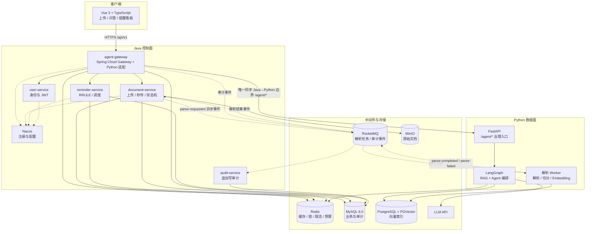

# 技术方案文档（TDD）

## 1. 背景与目标

「智能学习助手」面向需要频繁阅读课件、准备考试和跟进作业的学生，用异步文档解析与基于文档的 RAG 问答缩短“翻几十页找一句话”的时间，同时用课表与截止提醒降低遗漏。项目同时承担教学目标：用一个真实双栈项目演练需求、UML、契约、跨语言治理、审计与可观测性，而不是堆砌无法解释的框架。本期成功不是“页面能打开”，而是 P0 主链路可重复演示、所有失败都有明确状态、AI 调用有预算和审计证据。量化成功标准如下：

| 维度 | 本期成功标准 |
|---|---|
| 核心功能 | US-01 至 US-04、US-07 全部通过；US-06、US-08 在交付前通过；US-05 作为 P2 增强在不影响 P0/P1 的前提下交付；上传、解析、问答、提醒可一键启动演示 |
| 性能 | 问答 P95 不超过 8 秒、P99 不超过 12 秒；10MiB 文档解析 P95 不超过 60 秒；问答接口 deadline 15 秒 |
| 成本治理 | 预算超支次数为 0；每次问答都有 `agent_execution`；预算耗尽可在不继续调用 LLM 的情况下返回 |
| 安全与隔离 | 跨用户资源访问成功次数为 0；日志与审计中完整 PII、Prompt、密钥出现次数为 0 |
| 可恢复性 | Python 停机不影响登录、上传、提醒；PGVector 写成功但状态未更新可在 5 分钟内通过对账恢复 |
| 工程过程 | 阶段 0 至 5 的文档、契约、CR 记录齐全；所有接口可追溯到需求编号 |

## 2. 架构总览

系统坚持控制面与数据面分离：Java 负责身份、业务状态、持久化、审计和预算政策，Python 负责解析、检索、Agent 编排和模型调用。前端只访问 Java Gateway，Java 只有 `agent-gateway` 允许发起同步 Python 调用，文档解析则通过 RocketMQ 以领域事件异步跨语言。下图中的 `/agent/*` 是**唯一同步 Java -> Python 调用边界**；`document-service -> RocketMQ -> Python Parser` 是异步事件边界，不是 Java 模块直接调用 Python。

这张图刻意不把 Python 放在业务请求的必经事务里：问答可以降级，上传和提醒必须继续可用；Nacos 只是注册与配置依赖，不参与数据所有权判断。问答治理协议与解析结果事件都必须有版本、幂等和错误分类，否则双栈边界会变成责任真空。

## 3. 模块职责与边界

模块边界遵循“谁拥有数据，谁负责状态；谁执行 AI，谁不碰业务持久化”。跨模块不共享 Repository，不直接读取对方表；同步调用只能经 Gateway，异步交互只能通过已定义的 MQ 事件。下表同时列出每个模块绝对不能承担的责任：

| 模块 | 核心职责 | 绝对不放进这个模块 |
|---|---|---|
| `common` | 统一响应、错误码、ProblemDetail、trace 上下文、通用 DTO | 用户/文档业务逻辑；数据库、Redis、MQ、MinIO 访问；Python HTTP 客户端 |
| `user-service` | 注册登录、密码哈希、JWT 签发与身份查询 | 文档、问答、提醒业务；调用 Python；审计存储 |
| `document-service` | 上传会话、MinIO 编排、MD5 秒传、文档状态机、解析事件投递、分块元数据落库 | RAG 检索、Prompt、Embedding、LLM 调用；用户表写入；直接调用 Python |
| `agent-gateway` | 入口路由、鉴权、限流、会话/消息元数据、治理参数、唯一 Python 客户端、超时熔断、审计 outbox | RAG 检索算法、LangGraph、Prompt 编排、向量库查询、用户表写入 |
| `reminder-service` | 提醒规则、RRULE/EXDATE 解析、下一次触发计算、调度与 due 事件 | 文档解析、LLM 调用；短信/邮件等外部通道实现 |
| `audit-service` | 消费审计事件、`audit_event` 追加写、按 traceId 查询 | UPDATE/DELETE 审计；业务决策；RAG/LLM；调用 Python |
| `ai-python` | 文档解析切分、Embedding、PGVector、RAG、LangGraph、LLM、工具、第二层 PII、预算硬停止 | 用户身份与授权、MySQL 业务表写入、审计权威存储、预算政策定义 |
| `frontend-vue` | 上传、问答、提醒看板；只调用 Java Gateway | 直连 Python；持有 LLM/MinIO 管理密钥；自行判断数据权限 |

其中 `agent-gateway` 同时承担边缘 Gateway 和 Python 适配器，是部署上的一个模块、逻辑上的两个阶段。`conversation`、`message`、`agent_execution` 归它管理，因此它可以可靠地在同一本地事务中写入执行记录并发出审计 outbox，而无需跨服务事务。

## 4. 技术选型与理由

选型优先满足“可运行、可解释、可治理”，而不是追求组件数量。Java 侧选择成熟的企业栈，Python 侧选择 AI 生态最完整的组合，中间件只引入解决明确问题的组件。

| 技术 | 选它的理由 | 备选方案及代价 |
|---|---|---|
| Spring Boot 3 + Spring Cloud Gateway | Java 17 生态成熟，Security、Validation、Actuator、JDBC、Nacos 集成完整；Gateway 能把入口鉴权、限流和 Python 适配收口，技术栈与行业主流一致 | Quarkus/Micronaut 启动更快，但 Gateway、Nacos、Observability 的资料与集成成本更高，没必要用生态换启动时间 |
| FastAPI | 原生 async，Pydantic v2 提供严格请求/响应校验和 OpenAPI，能直接承载 LangGraph、Embedding 与流式扩展；Python AI 生态完整 | Flask 缺少默认异步与类型校验，容易把契约散落在手工校验；Django 的 ORM/管理后台对本项目过重，且默认同步模型增加超时治理难度 |
| LangGraph | 用显式状态图表达检索、工具、重试和终止条件，支持 checkpoint、轮次上限和预算中断；比隐式 Agent 更容易测试和审计 | LangChain AgentExecutor 抽象较深，预算与终止点不易插入；自研循环可以完全可控，但会重复实现状态、重试、持久化和恢复 |
| RocketMQ | 适合解析任务与审计事件的异步解耦，支持消费重试、死信队列、顺序消息和事务消息；与“先落库再投递”的 outbox 方案匹配 | Kafka 吞吐更强但运维与 exactly-once 语义更复杂，本项目规模用不上；RabbitMQ 路由灵活，但重试/死信和事务消息能力对本场景不如 RocketMQ 直接 |
| PostgreSQL + PGVector | 在一个 PostgreSQL 实例内同时保存向量与向量侧元数据，支持按 `document_id` 的 SQL 过滤和 HNSW 索引，减少独立向量集群的运维成本 | Milvus/Qdrant 在亿级向量与高并发检索上更强，但需要额外集群、备份、监控和跨存储一致性，本项目十万级 chunk 规模不划算 |
| Redis | 同时解决秒传索引、解析锁、限流、问答缓存和 Agent 预算原子计数；TTL 与原子操作适合这些短生命周期状态 | Caffeine 只能单进程，无法约束多实例；直接用 MySQL 做计数和锁会增加核心库压力且缺少天然 TTL，限流与预算的原子性更难保证 |

最终没有选择“Java 也接一套向量库/模型 SDK”的双实现，因为那会让同一份 AI 能力出现两个事实来源；也没有选择“全部 Python”，因为鉴权、业务状态、审计和提醒事务不符合数据面职责。

## 5. 关键设计决策

以下三个决策决定系统的治理边界，每项都按「决策 -> 理由 -> 放弃的方案 -> 代价」记录，后续不能以“实现方便”为由静默推翻。

### 5.1 Agent 编排放在 Python，而不是 Java

- **决策：** LangGraph 状态机、RAG 检索、Prompt、工具调用全部在 Python；Java 只下发治理参数并调用 `/agent/ask`。
- **理由：** Python 拥有最成熟的模型/向量/Agent 生态，Prompt 与检索策略需要高频迭代；LangGraph 能用显式节点控制轮次、超时和预算中断，便于测试。
- **放弃的方案：** 在 Java 用 Spring AI 或自研 Agent 循环编排，再调用 Python 的单次 Embedding 接口。这样会把 Prompt、工具协议和模型重试分散到两边，谁 failed、谁重试、谁扣预算都无法统一。
- **代价：** 引入双语言部署与协议维护，Python 故障时问答不可用；通过契约测试、熔断、缓存、trace 透传和独立扩缩容控制代价，而不是把编排搬回 Java。

### 5.2 Java 侧不使用 Spring AI

- **决策：** Java 不引入任何 LLM SDK、Prompt 模板或向量检索框架，不直接调用模型供应商。
- **理由：** 一旦 Java 也能调模型，就会出现两套密钥、两套预算、两套重试和两套审计，并且 Prompt/RAG 逻辑会再次跨语言漂移；“只有 `agent-gateway` 能调用 Python”的边界也会失去意义。
- **放弃的方案：** 用 Spring AI 在 Java 实现一个“简单的问答兜底”，或在 Java 侧做 RAG 后再交给 Python 润色。前者会绕开 Python 的预算硬停止，后者会让检索结果与引用规则出现两个版本。
- **代价：** Python 宕机时 Java 无法独立生成答案，只能返回缓存命中结果或明确的 503；这是有意选择的故障边界，用可用性换单点治理和审计一致性。

### 5.3 审计数据落 Java，不由 Python 作为权威存储

- **决策：** 审计的权威数据写入 Java 的 `audit-service`，Python 只返回审计信号和工具执行细节，不能成为最终审计库。
- **理由：** 审计需要稳定的身份、权限、保留策略和不可删除保证；Python 是无状态执行面，可能在返回前崩溃，也没有用户所有权信息。只有 Java 能把审计与 `userId`、会话、执行状态和资源访问统一起来。
- **放弃的方案：** 只写 Python 日志或 Python 侧数据库，再由日志平台拼装；这会丢失身份与业务上下文，也无法可靠执行“禁止 UPDATE/DELETE”。
- **代价：** 协议要携带 `auditEvents`，Java 需要本地事务 + outbox 和幂等消费，审计可见性有秒级延迟；这些成本换来可验证的追加写和跨语言 trace 证据。

## 6. 风险与降级

最大风险不是“功能少”，而是 AI 依赖和双存储一致性让主链路在异常时失控。降级原则是：控制面先活下来，AI 能力明确降级，永不伪造答案，所有降级都有审计信号。具体策略如下：

| 风险 | 识别信号 | 降级策略 | 恢复方式 |
|---|---|---|---|
| Python 服务不可用 | `/agent/*` 连接拒绝、5xx、超时率超过阈值；Circuit Breaker 打开 | 仅返回同用户、同文档版本、仍有效的缓存答案；无缓存时返回 HTTP 503 `AGT-UPSTREAM-001`，绝不编造；上传和提醒继续；解析任务留在 MQ 等待消费者恢复 | 熔断 30 秒后半开探测；Python 恢复后 MQ 消费补偿解析任务，问答恢复 |
| LLM 超时或持续 5xx | 单次模型调用超时、错误率上升、deadline 剩余不足 | 在 `deadlineMs` 内最多重试 1 次；剩余时间足够时返回带引用的原文摘录，并明确标记为低置信度；否则返回 504 `AGT-UPSTREAM-002`；停止继续消耗 token | 熔断和退避；恢复后从检索结果重跑；对超时执行记录和预算写入审计 |
| PGVector 写成功但状态更新失败 | 文档长时间 `PARSING`；PGVector 已有向量但 MySQL 无 `INDEXED`；完成事件缺失 | 文档不进入 `INDEXED`；消费者幂等重试；对账任务扫描超过阈值的 `PARSING` 并重投解析；Python 使用 `documentId + indexVersion + chunkIndex` 确定性 ID 跳过重复向量 | 对账成功后单事务写入分块元数据并推进状态；超过重试上限进入 `FAILED/DEAD` 并告警，不把半成品暴露给 RAG |

降级不是“吞掉异常”：每次熔断、预算耗尽、低置信度和审计回传失败都必须产生结构化日志和审计事件，并在前端用不同错误码区分。对账与重试必须幂等，否则补偿本身会成为新的重复数据来源。

---

拦截的是什么问题：拦截“双栈项目只有架构图、没有技术取舍和失败路径”的伪设计，尤其是把 Agent、Prompt、审计散落到两侧后产生的预算失控、责任不清与不可恢复的跨存储不一致。
