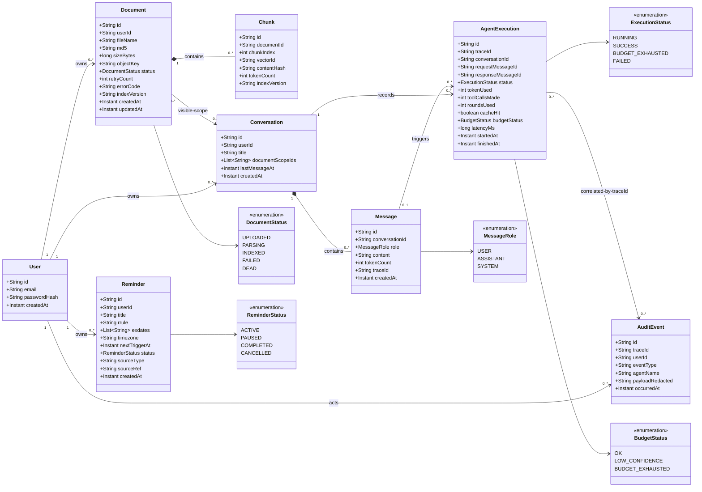
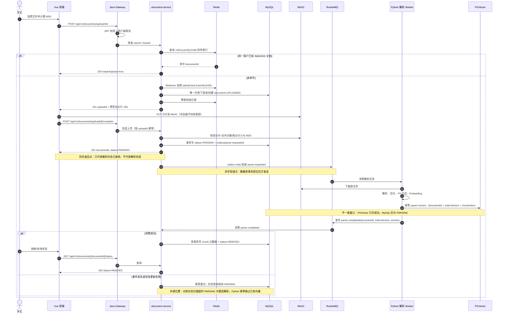
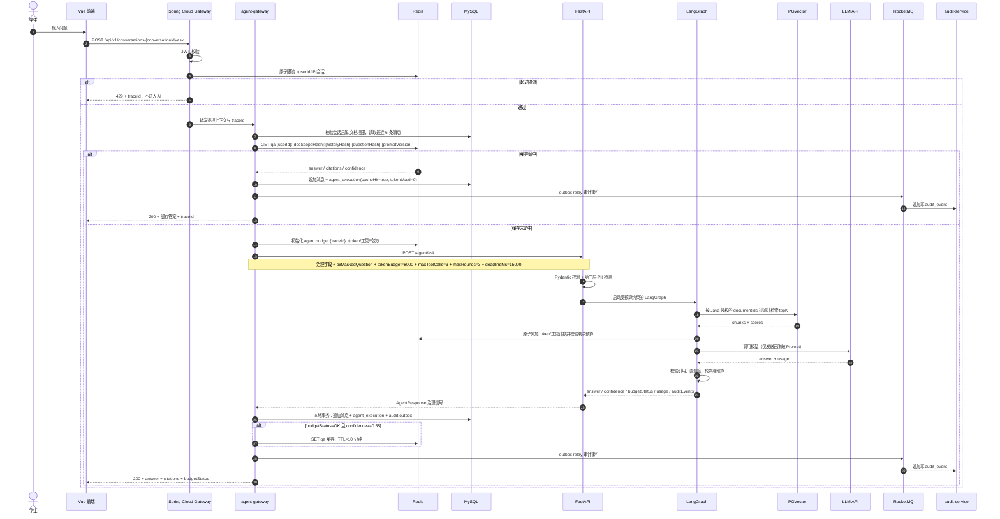
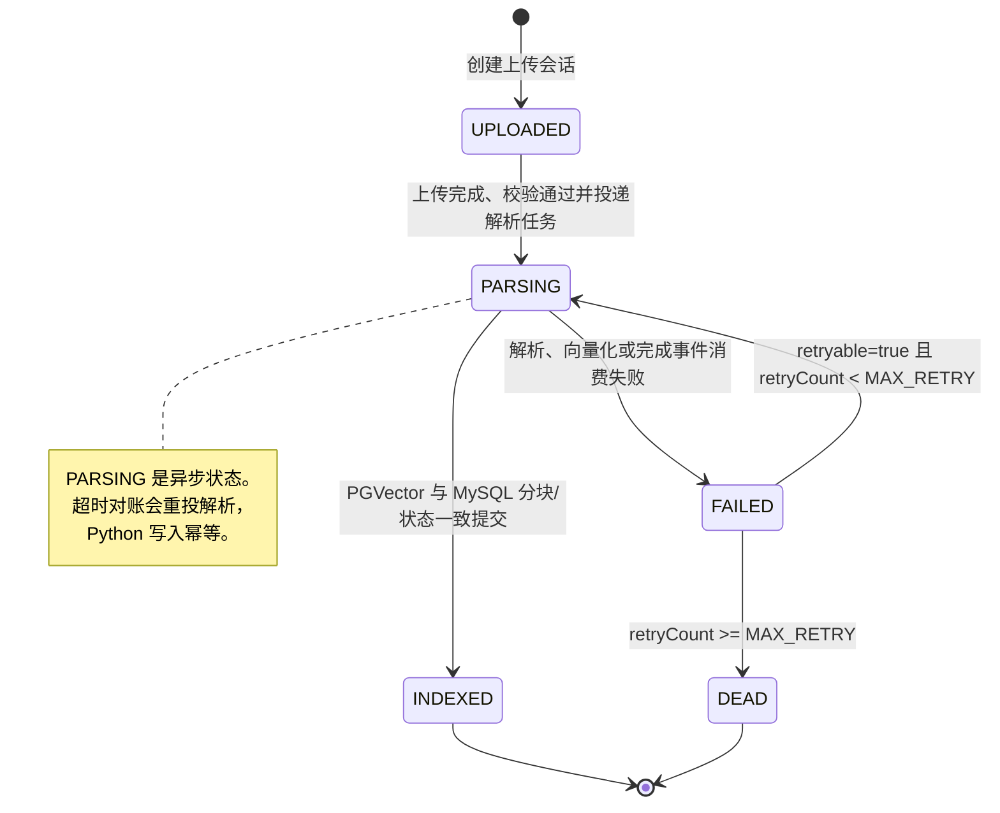

# UML 建模与关键流程

## 1. 类图：业务实体与所有权

**这张图在评审会上回答：哪些数据是强拥有关系、文档状态以哪张表为准、Agent 执行与审计如何关联，以及分块和 PGVector 的边界在哪里。**

关键约束：

- `Document -> Chunk`、`Conversation -> Message` 是强拥有关系，文档或会话被移除时不得留下孤儿分块或消息；`User`、`Document`、`Conversation`、`Reminder` 都以 `userId` 作为所有权边界。
- `AgentExecution` 是每次问答尝试的执行事实，必须记录 `traceId`、`tokenUsed`、`toolCallsMade`、`roundsUsed` 和四种状态 `RUNNING/SUCCESS/BUDGET_EXHAUSTED/FAILED`；重试会产生新的执行记录，不能覆盖旧记录。
- `AuditEvent` 是不可变追加表，通过 `traceId` 与执行记录关联，不依赖外键级联；它不能因为删除会话、消息或执行记录而消失。
- PGVector 中保存 `content + embedding + metadata`，MySQL `Chunk` 只保存控制面需要的分块元数据与 `vectorId`；`vectorId` 是跨存储的稳定映射，不直接拿数据库自增主键充当向量主键。
- `Conversation.documentScopeIds` 是逻辑访问范围，不是物理多对多关联表；检索前仍由 Java 按 `userId` 和文档状态复核，不能只信任前端传入的 ID 列表。
- `BudgetStatus` 中的 `LOW_CONFIDENCE` 与 `BUDGET_EXHAUSTED` 不是执行状态；低置信度可以是 `SUCCESS`，预算耗尽则同时体现在 `AgentExecution.status` 和 `budgetStatus`。

## 2. 序列图一：文档上传到解析完成

**这张图在评审会上回答：上传请求在哪个时刻同步返回、解析任务何时异步投递、并发如何避免重复，以及 PGVector 与 MySQL 不一致时到底由谁补偿。**

流程解释：

- **同步返回点**是 `202 documentId, status=PARSING`：它只承诺任务已被事务性接收，不承诺解析成功。真正的解析在 outbox 消息发出后才开始。
- **异步投递点**是 outbox relay 向 RocketMQ 发送 `parse-requested`。先写数据库再发消息，避免“任务已投递但状态没落库”的方向性错误。
- **不一致窗口**发生在 Python 已成功 upsert PGVector、`parse-completed` 尚未被 `document-service` 成功消费的这段时间。文档会暂时停留在 `PARSING`，用户不会看到半成品答案。
- **补偿位置**在 `document-service` 的重试与对账：消费者先做幂等重试；超过阈值的 `PARSING` 文档由定时对账任务重投解析。Python 使用确定性向量 ID 和 upsert，重复执行不会产生重复分块。
- `complete` 和 `parse-completed` 都必须幂等，重复事件只允许产生一次状态推进和一次分块元数据写入。

## 3. 序列图二：用户提问到返回回答

**这张图在评审会上回答：一次问答如何在限流、缓存、预算、RAG、审计之间形成闭环，缓存命中与未命中分别经过哪些节点，以及失败信号最终回到哪里。**

流程解释：

- **限流在 Java Gateway 完成**，发生在任何缓存与 Python 调用之前。限流命中时只返回 429 和 `traceId`，不消耗 token，也不进入 LangGraph。
- **缓存命中路径**仍然写 `agent_execution` 和审计，只是 `tokenUsed=0`、`cacheHit=true`。缓存键包含 `userId`、文档范围、历史摘要、问题摘要和 Prompt 版本，禁止跨用户或跨文档版本复用答案。
- **缓存未命中路径**由 `agent-gateway` 组装全部治理字段；Python 只拿到已授权文档 ID、已脱敏问题与不可突破的上限，不直接访问用户表。
- **Python 在每次 LLM/工具调用前检查预算**，Redis 计数器提供跨进程硬停止能力；Java 在响应返回后核对 `tokenUsed/toolCallsMade/roundsUsed` 并写入权威执行记录。
- **审计回写**以 Java 本地事务中的 outbox 为主：消息入队与执行记录、消息记录同事务提交，再由 MQ 异步送 `audit-service`。Python 返回的 `auditEvents` 是证据输入，不是最终审计存储。
- 只有 `budgetStatus=OK` 且置信度达到阈值时才写缓存；`LOW_CONFIDENCE` 与 `BUDGET_EXHAUSTED` 都不能被缓存为一次成功答案。

## 4. 状态图：Document 生命周期

**这张图在评审会上回答：文档在什么条件下可以被问答、失败后何时重试、什么情况下彻底停止自动处理，以及人工重试是否被允许。**

状态解释与不变量：

- 只有 `document-service` 可以推进 `Document` 状态，Python 只能通过 `parse-completed/failed` 事件提供事实，不能直接改 MySQL 的 `document` 行。
- `UPLOADED` 只允许进入 `PARSING`；非法跳转（例如直接调用内部接口把文档改成 `INDEXED`）必须拒绝并记录审计。
- `INDEXED` 表示“状态、分块元数据、向量写入”已经达到可检索条件，不表示 PGVector 与 MySQL 永远一致；一致性靠版本号、幂等写入和对账持续维护。
- 瞬时错误按指数退避重试，`retry_count` 达到上限进入 `DEAD`。加密 PDF 等永久错误标记为不可重试，停留在 `FAILED` 并指导用户重新上传，不占用自动重试次数。
- 人工重试只允许用于 `FAILED` 且错误可重试、或 `DEAD` 且管理员已确认基础设施恢复的场景；重试会递增 `retry_count` 并要求幂等处理，不能重复生成分块。

---

拦截的是什么问题：拦截“实体关系只画在文档里、状态机和补偿逻辑却各自实现”的不一致，尤其是上传并发、PGVector 写成功但状态未更新、以及问答审计只存在 Python 侧的链路盲区。
