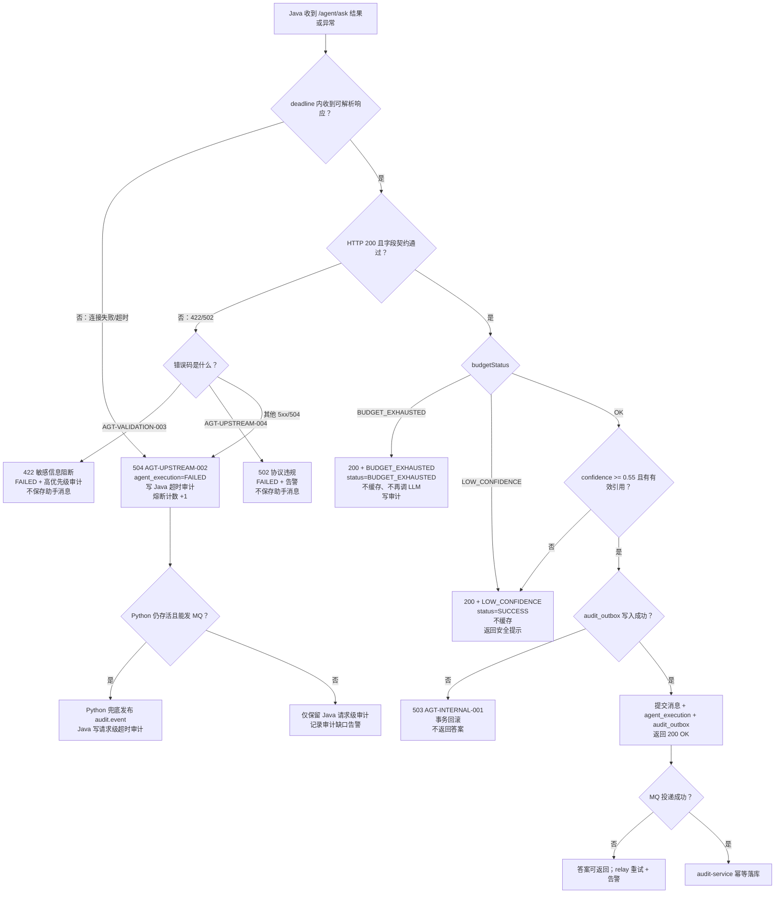

# Java ↔ Python 跨语言治理协议

## 0. 协议范围与总则

本协议只约束唯一同步跨语言边界：`agent-gateway -> ai-python POST /agent/ask`。文档解析仍走 RocketMQ 异步事件，不适用本文的同步请求/响应格式，但必须遵守同一套 trace、幂等和 PII 原则。S2 起异步边界多了一条：**向量变更消息**（`vector-change-requested` / `vector-change-completed`），它不适用 §1–§2 的同步格式，但 §5 为它单独定义契约，§0 的总则对两者一律生效。S5 的 §7 **不是新边界也不是新契约**：它登记的是 Python 进程内部的检索阶段顺序与降级语义，跨语言字段零变更。

| 项目 | 约定 |
|---|---|
| 协议版本 | `protocolVersion=1.0`；主版本不兼容时拒绝请求，次版本只允许可选字段增加 |
| 传输 | 内网 HTTPS，`Content-Type: application/json`，UTF-8；服务间使用 mTLS 或内部凭证，不传用户 JWT |
| 成功响应 | HTTP 200，`AgentResponse` JSON |
| 错误响应 | HTTP 422/500/503/504，`application/problem+json`，字段对齐 RFC 9457，并扩展 `code/traceId/errors/auditEvents` |
| 时间 | `occurredAt/finishedAt` 使用 ISO 8601 UTC；`deadlineMs` 是相对毫秒，不是绝对时间 |
| 严格性 | Python Pydantic 模型对未知字段默认 `forbid`；新增字段必须先在协议中登记为可选 |
| 幂等 | 一个 `traceId` 对应一次逻辑执行；Java 不自动重试已发出的 `/agent/ask`。需要重试时生成新 `traceId` 和新执行记录 |
| 安全 | Python 不信任 `userId` 做授权；授权只由 Java 在调用前完成。Python 只使用 Java 传入的已授权文档范围 |

Java 对外接口与 Python 内部接口的错误码不同：Python 返回 `AGT-*` 问题详情，Java 负责映射为对外 `ProblemDetail`，不得把 Python 堆栈、内部地址或原始异常返回给前端。

## 1. 第一部分：请求协议

### 1.1 必带治理字段

以下字段全部必填。缺失或非法时，Python 在开始任何检索、LLM 或工具调用之前拒绝请求，返回 HTTP 422、错误码 `AGT-UPSTREAM-004`，并在 `errors[].field` 指向具体字段。协议错误不消耗 token，但 Java 仍要写一条 `AGENT_PROTOCOL_VIOLATION` 审计事件。

| 字段 | 类型与约束 | 谁生成 | Python 如何使用 | 缺失/非法行为 |
|---|---|---|---|---|
| `protocolVersion` | string，`^[0-9]+\.[0-9]+$`，示例 `1.0` | `agent-gateway`，读取配置 | 校验主版本为 `1`；决定字段兼容策略 | 缺失或不支持：422 `AGT-UPSTREAM-004`，`field=protocolVersion` |
| `userId` | UUID v7 字符串 | `agent-gateway` 从 JWT `sub` 提取，绝不从请求体透传 | 作为预算/缓存 Key 命名空间和审计关联标识；**不做授权判断** | 缺失或非 UUID：422 `AGT-UPSTREAM-004`，`field=userId` |
| `traceId` | 32 位小写十六进制，符合 W3C Trace Context | `agent-gateway` 生成或继续上游 trace | 作为 OpenTelemetry trace、预算 Key、审计关联键；必须原样回传 | 缺失/格式错误：422 `AGT-UPSTREAM-004`，`field=traceId` |
| `conversationId` | UUID 字符串 | `agent-gateway` 从路径参数取得，并已校验归属 | 作为会话记忆/检查点命名空间和审计关联；不得用于跨用户读取 | 缺失/非 UUID：422 `AGT-UPSTREAM-004`，`field=conversationId` |
| `question` | string，1..4000 字符，去除首尾空白后非空 | `agent-gateway` 从请求体归一化后传入 | **只用于第二层 PII 差分检测**；不得写入日志、审计、Prompt 或发送给 LLM | 缺失/空白/超长：422 `AGT-UPSTREAM-004`，`field=question` |
| `piiMaskedQuestion` | string，1..4000 字符，不能为空 | `agent-gateway` 第一层脱敏后的文本 | 第二层复检通过后，作为唯一的用户问题输入 Prompt | 缺失/空白：422 `AGT-UPSTREAM-004`；若仍含原始 PII：422 `AGT-VALIDATION-003` |
| `piiMaskingVersion` | string，`^pii-v[0-9]+$`，当前 `pii-v2`（兼容 `pii-v1`） | `agent-gateway` 读取脱敏器版本 | 校验是否在支持列表；按版本执行对应复检规则 | 缺失/不支持：422 `AGT-UPSTREAM-004`，`field=piiMaskingVersion` |
| `tokenBudget` | integer，1..8000 | `agent-gateway` 按用户/请求策略计算 | 作为总 token 硬上限；每次 LLM 调用前和调用后原子检查并累计 | 缺失/非整数/<=0/大于 8000：422 `AGT-UPSTREAM-004`，`field=tokenBudget` |
| `maxToolCalls` | integer，0..3 | `agent-gateway` | 工具调用硬上限；达到上限后禁止再调用任何工具 | 缺失/越界：422 `AGT-UPSTREAM-004`，`field=maxToolCalls` |
| `maxRounds` | integer，1..3 | `agent-gateway` | LLM 决策轮次硬上限；达到上限后只能结束并返回已有结果 | 缺失/越界：422 `AGT-UPSTREAM-004`，`field=maxRounds` |
| `allowedTools` | string[]，最多 10 个；元素为内置名 `document_search`、`calculator`、`current_time`，或 MCP 名 `mcp__<server>__<tool>`（两段各 `[a-z0-9_]{1,32}`） | `agent-gateway` 按场景和用户策略下发 | 只允许执行白名单内工具；MCP 名还须同时命中 Python 启动期 MCP 允许表与实际发现的工具；空数组表示本轮不允许任何工具 | 缺失/含未知工具：422 `AGT-UPSTREAM-004`，`field=allowedTools` |
| `deadlineMs` | integer，100..15000 | `agent-gateway` 按请求开始时间和剩余预算计算 | 从收到请求起建立单调时钟 deadline；到点必须停止并返回，不得继续后台调用 | 缺失/<=0/大于 15000：422 `AGT-UPSTREAM-004`，`field=deadlineMs` |

### 1.2 授权范围与上下文

这两个字段不是可选的“附加信息”，而是 Python 能在不接触业务库的前提下安全工作的最小上下文。缺少授权范围时，Python 不得自行检索全部文档。

| 字段 | 类型与约束 | 谁生成 | Python 如何使用 | 缺失/非法行为 |
|---|---|---|---|---|
| `documentScopes` | array，1..20 项；每项 `{documentId: UUID, indexVersion: string 1..32}`；文档 ID 不得重复 | `agent-gateway` 在查询 `document` 表并校验 `userId/status=INDEXED` 后生成 | 只能在该集合内过滤 PGVector；不接受前端追加的文档 ID；空集合不进入 RAG | 缺失/空/重复/非法：422 `AGT-UPSTREAM-004`，`field=documentScopes` |
| `history` | array，0..6 项；每项 `{role: USER|ASSISTANT, piiMaskedContent: string 1..4000}`；总 token 目标 <=2000 | `agent-gateway` 从最近消息读取，并对 USER 内容重新执行第一层脱敏 | 作为对话上下文；Python 可丢弃最旧消息以满足 2000 token 上限，并记录 `historyTruncated` 审计 | 缺失时按空数组处理；超过 6 项、role 非法或内容含原始 PII：422 `AGT-UPSTREAM-004` 或 `AGT-VALIDATION-003` |

补充约束：

1. `documentScopes.indexVersion` 必须来自 Java 的授权查询，不能由前端指定；Python 只把 `(documentId, indexVersion)` 作为向量过滤条件。
2. `history` 的 USER 内容必须已脱敏；ASSISTANT 内容若来自历史回答，也应经过同样的输出 PII 检查。Python 第二层仍会对最终 Prompt 复检。
3. `allowedTools=[]` 是合法的“禁用工具”语义，不等同于字段缺失。
4. `deadlineMs` 是总截止时间，不是单个 LLM 调用的超时。Python 必须把剩余时间继续传给下游调用，不能每个调用重新获得 15 秒；到点仍未安全结束时返回 504 `AGT-UPSTREAM-002`，不能返回 `BUDGET_EXHAUSTED` 冒充预算耗尽。
5. `tokenUsed` 统计所有 LLM 调用的输入 token + 输出 token；工具返回内容在被拼入下一次 Prompt 时计入下一次输入。Embedding 检索不计入 token 预算，但计入延迟和审计。

### 1.3 请求示例

```json
{
  "protocolVersion": "1.0",
  "userId": "0192f3a4-7b2c-7d10-9e8f-1234567890ab",
  "traceId": "4bf92f3577b34da6a3ce929d0e0e4736",
  "conversationId": "0192f3a4-8c3d-7e21-8f90-abcdef123456",
  "question": "请解释第三章的梯度下降，并举一个例子。",
  "piiMaskedQuestion": "请解释第三章的梯度下降，并举一个例子。",
  "piiMaskingVersion": "pii-v1",
  "tokenBudget": 8000,
  "maxToolCalls": 3,
  "maxRounds": 3,
  "allowedTools": ["document_search", "calculator"],
  "deadlineMs": 15000,
  "documentScopes": [
    {
      "documentId": "0192f3a4-9d4e-7f32-8a01-1234567890ab",
      "indexVersion": "v1"
    }
  ],
  "history": [
    {
      "role": "USER",
      "piiMaskedContent": "上一轮我问了学习率的作用。"
    },
    {
      "role": "ASSISTANT",
      "piiMaskedContent": "学习率决定每次参数更新的步长。"
    }
  ]
}
```

### 1.4 请求错误响应示例

```json
{
  "type": "https://docqa.example/problems/agent-protocol",
  "title": "Agent protocol violation",
  "status": 422,
  "detail": "tokenBudget must be less than or equal to 8000",
  "instance": "/agent/ask",
  "code": "AGT-UPSTREAM-004",
  "traceId": "4bf92f3577b34da6a3ce929d0e0e4736",
  "errors": [
    {
      "field": "tokenBudget",
      "message": "must be <= 8000"
    }
  ],
  "auditEvents": []
}
```

## 2. 第二部分：响应协议

### 2.1 必含治理信号

Python 只有在完成或明确终止本次执行后才返回 HTTP 200。任何未捕获异常都必须转换为 5xx 问题详情，并尽可能携带已产生的 `auditEvents`，不能让 Java 只看到超时。

| 字段 | 类型与约束 | Java 侧决策 | 缺失/非法行为 |
|---|---|---|---|
| `protocolVersion` | string，必须回显 `1.0` | 不匹配则按协议违规处理，写 `AGENT_PROTOCOL_VIOLATION` 审计 | 缺失/不支持：502 `AGT-UPSTREAM-004`，FAILED，不保存回答 |
| `traceId` | 32 位小写十六进制，必须与请求一致 | 不一致则拒绝响应，标记 FAILED；防止串请求/串用户 | 缺失/不一致：502 `AGT-UPSTREAM-004`，FAILED，不保存回答 |
| `answer` | string，1..8000 字符；低置信度和预算耗尽也必须返回安全的说明文本 | 仅在 `agent_execution.audit_outbox` 成功写入后持久化助手消息 | 缺失/空/超长：502 `AGT-UPSTREAM-004`，FAILED，不缓存 |
| `citations` | array，0..20 项；每项含 `documentId`、`chunkIndex`、`score`、`snippet`；`snippet <=200` 字 | 校验每个 `documentId` 在本次授权范围内、`chunkIndex>=0`；越权引用按协议违规处理，不返回答案 | 缺失、越权文档、非法 chunk/score/snippet：502 `AGT-UPSTREAM-004`，FAILED |
| `confidence` | number，0..1 | 低于 `0.55` 时强制 `budgetStatus=LOW_CONFIDENCE`；与 Python 返回值冲突时 Java 采用更保守的值并写告警 | 缺失/越界：502 `AGT-UPSTREAM-004`，FAILED；与 budgetStatus 冲突时按更保守值处理并告警 |
| `budgetStatus` | 封闭枚举：`OK`、`BUDGET_EXHAUSTED`、`LOW_CONFIDENCE` | 决定 HTTP 200 的业务语义、缓存策略和 `agent_execution.status`；优先级见 2.2 | 缺失/未知枚举：502 `AGT-UPSTREAM-004`，FAILED |
| `tokenUsed` | integer，0..`tokenBudget` | 与 Redis 预算计数核对；超过请求上限即协议违规 | 缺失/负数/超过 `tokenBudget`：502 `AGT-UPSTREAM-004`，FAILED，不缓存 |
| `toolCallsMade` | integer，0..`maxToolCalls` | 用于核对工具审计事件 | 缺失/负数/超过 `maxToolCalls`：502 `AGT-UPSTREAM-004`，FAILED |
| `roundsUsed` | integer，0..`maxRounds` | 用于识别 Agent 循环未正确终止 | 缺失/负数/超过 `maxRounds`：502 `AGT-UPSTREAM-004`，FAILED |
| `auditEvents` | array，1..50 项；每项含 `eventId`、`eventType`、`agentName`、`severity`、`occurredAt`、`payloadRedacted` | 校验字段白名单后写入 Java 本地 `agent_execution.audit_outbox`；只有 Java 能注入权威 `traceId/userId` | 缺失/空数组/字段非法：502 `AGT-UPSTREAM-004`；Java 额外写 `AUDIT_GAP`，不保存回答 |
| `finishedAt` | ISO 8601 UTC | 用于计算 `latencyMs`；与 Java 收到响应的时间做偏差告警 | 缺失/非法：502 `AGT-UPSTREAM-004`，FAILED，不保存回答 |

### 2.2 `budgetStatus`、置信度与执行状态

```text
优先级从高到低：
1. 任一硬预算（token / 工具 / 轮次）被触发 -> BUDGET_EXHAUSTED
2. 未触发硬预算，但 confidence < 0.55 或无有效引用 -> LOW_CONFIDENCE
3. 其余 -> OK

deadline 不属于 budgetStatus：到点仍未完成时返回 504 AGT-UPSTREAM-002，
agent_execution=FAILED，不能伪装成 BUDGET_EXHAUSTED。
```

| Python 返回 | Java 持久化 `agent_execution.status` | 是否缓存 | 对外 HTTP | 用户可见语义 |
|---|---|---|---|---|
| `OK` 且 `confidence>=0.55` 且有引用 | `SUCCESS` | 是，TTL 10 分钟 | 200 | 正常回答，至少 1 条引用 |
| `LOW_CONFIDENCE` | `SUCCESS` | 否 | 200 | 明确说明资料不足，不编造结论；允许 0 条引用 |
| `BUDGET_EXHAUSTED` | `BUDGET_EXHAUSTED` | 否 | 200 | 返回预算耗尽说明；不再调用 LLM/工具 |
| 任何协议违规/字段越界 | `FAILED` | 否 | 502 `AGT-UPSTREAM-004` | 不展示未经治理的答案 |
| PII 漏脱敏被阻断 | `FAILED` | 否 | 422 `AGT-VALIDATION-003` | 请移除敏感信息后重试，不回显原文 |
| Python 超时/连接失败 | `FAILED` | 否 | 504/503 | 明确的 AI 暂不可用提示 |

`budgetStatus=LOW_CONFIDENCE` 不等于执行失败：`agent_execution.status` 仍可为 `SUCCESS`。`BUDGET_EXHAUSTED` 是硬停止，必须同时体现在 `budgetStatus` 和执行状态中。协议违规、PII 阻断、超时等未拿到有效响应就失败的记录，`agent_execution.budget_status` 置为 `NULL`，不得用 `OK` 填充。

三个枚举值分别拦截不同错误：

| 枚举值 | 拦截的问题 | 少一个会漏掉什么 |
|---|---|---|
| `OK` | 预算内、证据充分、引用有效 | 没有“正常成功”的基准，Java 无法区分可缓存答案与降级答案 |
| `BUDGET_EXHAUSTED` | token/工具/轮次任一硬上限触发 | Agent 可能继续调用 LLM/工具，或 Java 把超预算结果当普通成功缓存，成本治理失效 |
| `LOW_CONFIDENCE` | 检索证据不足或最高分低于 0.55 | 低置信度答案会被当正常答案展示和缓存，违反“不编造、要明确说不知道” |

**`confidence` 与引用 `score` 的语义边界。** Python 侧的计算口径是 `confidence = max(被引用块的向量余弦相似度)`（`agent/service.py:372-373`，再 clamp 到 `0..1`），引入 hybrid 召回后**这个含义一个字都不改**：

- 阈值 `0.55` 是按余弦语义定的，且 Java 侧在 `PythonResponseValidator.java:54-55` 校验取值 0..1 且有限、`:135` 用 `AgentProperties.java:48` 的同值阈值独立判读一次。**两端的阈值不是同一个判定**，Python 决定 `budgetStatus`，Java 决定它自己是否采信——这层重复是既有的治理设计，S5 不合并、不改动。
- 融合用的是名次而非分数（RRF，`k=60`），因为 `ts_rank` 与 `1 - 余弦距离` 实测不在同一尺度（30000 行语料上 `ts_rank` 落在 `0.0203..0.0746`，`ts_rank_cd` 只有 5–6 个不同值；余弦相似度在 S2 实链上约 `0.6..0.99`）。融合分**不会**被写进 `confidence`，也不会被写进 `score`。
- 只被词法通道命中、向量通道没给的块，对外 `score = 0.0`，且**不参与 `confidence` 取最大值**。因此「引用来自词法」在协议里是**不可见**的：`Citation` 不带来源通道字段，`StrictModel` 禁止 extra 字段，本期也不新增（改协议属跨语言变更，不在 S5）。这条局限由 S5 如实登记，判据留给 。
- 由此有一个必须预防的误读：**只有词法块被引用时 `confidence` 恒为 0.0**，因而必然落到 `LOW_CONFIDENCE`。这是有意的保守（不假装知道相似度），不是缺陷；界面对这种情形的解释口径归 S10。

### 2.3 成功响应示例

```json
{
  "protocolVersion": "1.0",
  "traceId": "4bf92f3577b34da6a3ce929d0e0e4736",
  "answer": "梯度下降通过沿损失函数负梯度方向迭代更新参数。学习率决定每步步长；过大可能震荡，过小则收敛缓慢。",
  "citations": [
    {
      "documentId": "0192f3a4-9d4e-7f32-8a01-1234567890ab",
      "chunkIndex": 12,
      "score": 0.87,
      "snippet": "梯度下降沿负梯度方向更新参数，学习率控制步长。"
    }
  ],
  "confidence": 0.87,
  "budgetStatus": "OK",
  "tokenUsed": 1260,
  "toolCallsMade": 1,
  "roundsUsed": 2,
  "auditEvents": [
    {
      "eventId": "0192f3a4-a1b2-7c33-9d01-1234567890ab",
      "eventType": "RAG_RETRIEVED",
      "agentName": "rag_retriever",
      "severity": "INFO",
      "occurredAt": "2026-10-20T10:15:01.120Z",
      "payloadRedacted": {
        "chunkCount": 6,
        "durationMs": 182,
        "topScore": 0.87
      }
    },
    {
      "eventId": "0192f3a4-a2c3-7d44-8e02-1234567890ab",
      "eventType": "LLM_CALLED",
      "agentName": "llm_client",
      "severity": "INFO",
      "occurredAt": "2026-10-20T10:15:02.010Z",
      "payloadRedacted": {
        "durationMs": 2100,
        "tokenCount": 1260,
        "model": "configured-model",
        "round": 2
      }
    }
  ],
  "finishedAt": "2026-10-20T10:15:02.200Z"
}
```

### 2.4 `auditEvents` 字段白名单

`payloadRedacted` 必须使用白名单字段，禁止放完整问题、完整 Prompt、回答原文、文档片段、文件路径、手机号、身份证号、邮箱、API Key 或连接串。未知字段直接丢弃并写 `AUDIT_PAYLOAD_REJECTED` 告警；如果无法安全裁剪，整条响应按协议违规处理。

| 字段 | 类型 | 用途 |
|---|---|---|
| `durationMs` | integer >=0 | 节点耗时 |
| `tokenCount` | integer >=0 | 本次 LLM token 用量 |
| `toolName` | string，枚举：内置名 `document_search`/`calculator`/`current_time`，或 `mcp__<server>__<tool>`（两段各 `[a-z0-9_]{1,32}`） | 工具名；MCP 名由 `server` 段直接表达来源 |
| `toolSource` | string，枚举 `builtin`/`mcp` | 工具来源；响应内审计事件必带，供 Java 侧区分内置工具与 MCP 工具 |
| `chunkCount` | integer >=0 | 召回分块数 |
| `topScore` | number 0..1 | 最高重排序分数 |
| `round` | integer >=1 | Agent 轮次 |
| `confidence` | number 0..1 | 本轮置信度 |
| `budgetStatus` | enum | 预算状态 |
| `errorCode` | string，错误码格式 | Java/Python 错误码 |
| `maskingVersion` | string | PII 脱敏器版本 |
| `piiCategories` | string[]，枚举 `PHONE/ID_CARD/EMAIL` | 命中的 PII 类别，不含原文 |
| `piiCount` | integer >=0 | 命中数量，不含原文 |
| `model` | string，<=64 | 模型标识，不含密钥 |
| `cacheHit` | boolean | 是否缓存命中 |
| `historyTruncated` | boolean | 是否因 token 上限丢弃历史 |
| `targetUserId` | string，UUID | 管理动作的目标用户；只用于 `ADMIN_AI_QUOTA_UPDATED` / `ADMIN_AI_QUOTA_CLEARED`，Kill Switch 事件不携带 |

`eventId` 由 Python 生成 UUID，Java 以此做 MQ 重复投递和同步/异步双通道去重。`traceId`、`userId` 由 Java 在入库时注入并覆盖任何上游值，防止 Python 伪造归属。

**白名单当前为 17 键**（S7 加入 `toolSource` 后为 16，S9 加入 `targetUserId` 后为 17；网关在 S7 漏同步 `toolSource`，S9 一并补回，即 ``）。三处实现逐字对齐：Python `governance/audit.py` 的 `ALLOWED_PAYLOAD_KEYS`、`agent-gateway` 的 `AuditEventValidator.ALLOWED_KEYS`、`audit-service` 的 `AuditPayloadSanitizer.ALLOWED_KEYS`。`agent-gateway` 的 `AuditPayloadKeySetContractTest` 在每次 `mvn verify` 时解析另两侧源码并与运行期集合比对，任何一侧少键都会直接变红。网关与 audit-service 对未知键的处理不同：网关丢弃并追加 `AUDIT_PAYLOAD_REJECTED`，audit-service 丢弃并记录 `droppedFields`；两者都不回显被丢弃的键值。`targetUserId` 在 Python 与 audit-service 两侧都校验 UUID 形态，网关只做长度与类型预过滤。

## 3. 第三部分：审计回传通道与降级决策树

### 3.1 两条通道对比

| 维度 | 同步随响应返回 `auditEvents` | 异步 MQ 回传 `audit.event` |
|---|---|---|
| 捕获时机 | Python 结束前把事件放入响应 | Python 在事件发生时或结束时发布 |
| 与回答的一致性 | 强：同一响应携带治理信号 | 弱：可能先到/后到、重复或乱序 |
| 丢失窗口 | Python 崩溃在中途且未返回时，本次内部事件丢失 | Python 发布前崩溃会丢失；发布后由 MQ 保证至少一次 |
| Java 崩溃影响 | Java 未提交本地事务时用户拿不到成功响应 | 已发布事件仍可被消费；但若 Java 没写请求级审计，仍缺上下文 |
| 延迟 | 无额外投递延迟 | 秒级延迟，需要监控积压 |
| 重复处理 | 依赖 Java 事务和 `eventId` 去重 | 依赖消费者幂等和 `eventId` 唯一键 |
| 负载/耦合 | 响应体变大，受同步链路超时影响 | 增加 MQ 主题、生产者和消费积压治理 |
| PII 风险 | 事件白名单必须在返回前裁剪 | 同样必须裁剪，且更难在发送前统一检查 |

### 3.2 选择：同步返回为主，Python 直发 MQ 为兜底

- **主路径：** Python 在 HTTP 200 响应中返回 `auditEvents`；Java 在同一个本地事务中写入助手消息、`agent_execution` 终态快照及其 `audit_outbox`，然后才向用户返回成功。RocketMQ 在这里负责把 **`agent_execution.audit_outbox`** 投递给 `audit-service`，`audit_event` 表不是第一落点。
- **兜底路径：** Python 在超时、被取消、返回 5xx 或连接中断前仍存活时，直接把同一批 `auditEvents` 发布到 `audit.event` 主题；Java 同时写自己的超时/失败审计。两条路径用 `eventId` 去重。
- **不采用的方案：** 只让 Python 异步发 MQ、Java 不保存同步审计信号。这样主链路返回成功后 Java 崩溃会留下无法关联用户和会话的孤儿事件，无法满足“审计权威在 Java”的约束。

### 3.3 Java 侧降级决策树



### 3.4 关键边界

1. **`audit_outbox` 写失败时不能返回成功答案。** 事务回滚消息、执行记录和 `audit_outbox`；Python 已生成答案也不展示，用户收到 503。否则会出现“用户看到了答案，但系统没有任何证据”的合规缺口。
2. **MQ 投递失败不等于审计丢失。** `audit_outbox` 已随执行快照持久化，relay 可重试；此时可以返回答案，但必须告警并监控积压。审计可见性允许秒级延迟，不允许无记录。
3. **Python 超时且已崩溃时，只能保留请求级事实。** Java 能证明“某用户在某 trace 发起过问答并超时”，但无法还原 Python 内部每一步；这是分布式系统的残余风险，必须通过超时/缺口告警显式暴露，不能伪装成完整审计。
4. **缓存命中仍写审计。** `tokenUsed=0`、`cacheHit=true`，但请求、文档范围和回答引用都要有记录，不能把缓存命中当成“没有发生 AI 调用”。
5. **低置信度不是失败。** 仍返回 200，但不得缓存，不得生成无引用结论；执行记录为 `SUCCESS + LOW_CONFIDENCE`。

### 3.5 对自检问题的回答

**“审计走 MQ 异步，主链路已返回用户但服务崩溃导致审计丢失，能否接受？”**

不能接受“只走异步 MQ 且没有本地持久化”的方案。本设计把审计捕获和审计投递分开：捕获在 Java 本地事务的 `agent_execution.audit_outbox` 中完成，且发生在返回用户之前；MQ 只负责投递。若 Java 在提交前崩溃，用户不会看到成功响应；若在提交后崩溃，`audit_outbox` 仍可重试。只有 Python 内部明细在 Python 崩溃时可能缺失，但请求级事实由 Java 保留，并以审计缺口告警显式暴露；这不是静默丢失。

## 4. 第四部分：PII 双层脱敏

### 4.1 数据流与信任边界

```text
前端
  -> Java Gateway：JWT/限流/第一层规则脱敏
  -> /agent/ask：original question + piiMaskedQuestion + version + 授权范围
  -> Python 第二层复检
  -> 最终 Prompt 门禁（问题 + 历史 + 检索片段）
  -> LLM
```

- Java 第一层在跨信任边界前执行；原始问题可保存在 MySQL `message.content` 作为业务数据，但禁止进入应用日志、审计 payload、异常消息和 Python 日志。
- Python 收到 `question` 仅用于第二层差分检测；不得持久化、不得写入日志、不得拼入 Prompt、不得发送给 LLM。`piiMaskedQuestion` 才是模型输入。
- 检索片段可能来自用户课件，天然可能含邮箱、电话等；这部分由 Python 在拼 Prompt 前脱敏，不要求 Java 预先改写文档内容。

### 4.2 两层模式清单

| 层级 | 模式 | 处理 | 版本/说明 |
|---|---|---|---|
| Java 第一层 | 中国大陆手机号 | 正则匹配 `+86`/空格/连字符变体，替换为 `[PHONE]` | `pii-v1`；不保留后四位 |
| Java 第一层 | 18 位居民身份证号 | 匹配 18 位（末位可为 X），替换为 `[ID_CARD]`；兼容 15 位旧号 | `pii-v1`；不保留出生日期片段 |
| Java 第一层 | 邮箱 | 匹配常见 RFC 5322 子集，替换为 `[EMAIL]` | `pii-v1`；不保留域名 |
| Java 第一层 | 银行卡号（v2 新增） | 16~19 位 + 常见卡组织前缀（62/4/51-55）+ Luhn 校验，替换为 `[BANK_CARD]` | `pii-v2`；无前缀或 Luhn 失败的长数字不遮，避免误伤订单号 |
| Java 第一层 | 护照号（v2 新增） | `E/G/S/D/P` + 8 位数字，替换为 `[PASSPORT]` | `pii-v2`；2019 版及现行 |
| Java 第一层 | 社保号（v2 新增） | 美式 `123-45-6789`，替换为 `[SSN]` | `pii-v2`；带分隔符，误报面窄 |
| Java 第一层 | 归一化 | NFKC、全角数字转半角、移除零宽字符后再检测；掩码作用于归一化副本 | 防止全角/零宽绕过 |
| Python 第二层 | 同一组手机号/身份证/邮箱规则 | 对 `piiMaskedQuestion` 和历史消息复检；命中即判定 Java 漏脱敏 | 规则版本必须与 `piiMaskingVersion` 匹配 |
| Python 第二层 | 差分检测 | 比较 `question` 与 `piiMaskedQuestion` 的 PII 类别；只记录类别和数量，不记录原文 | 用于证明第一层确实执行 |
| Python 第二层 | 检索片段门禁 | 对召回 chunk 和最终 Prompt 再检测；命中则掩码后继续 | 文档内容可能合法包含联系方式，不能一律阻断 |
| Python 第二层 | 最终 Prompt 门禁 | 拼装完成后、调用 LLM 前做最后一次检测；仍命中则阻断 | 防止模板拼接/工具输出绕过 |
| Python 第二层 | 输出门禁 | `answer` 返回前复用手机号/身份证/邮箱规则；命中则掩码并写 `PII_MASKED_IN_OUTPUT` 审计，无法安全掩码则阻断 | 防止模型复述输入或检索片段中的 PII |

正则示意（实现时必须使用编译后的常量并配单元测试，不要在运行时拼接用户输入）：

```text
PHONE:   (?<!\d)(?:\+?86[\s-]?)?1[3-9]\d{9}(?!\d)
ID_CARD: (?<!\d)[1-9]\d{5}(?:18|19|20)\d{2}(?:0[1-9]|1[0-2])(?:0[1-9]|[12]\d|3[01])\d{3}[\dXx](?!\d)
EMAIL:   [A-Za-z0-9._%+-]+@[A-Za-z0-9.-]+\.[A-Za-z]{2,}
```

掩码占位符固定为 `[PHONE]`、`[ID_CARD]`、`[EMAIL]`（`pii-v1`），`pii-v2` 增加 `[BANK_CARD]`、`[PASSPORT]`、`[SSN]`；不生成可逆哈希、不保留原文片段。`pii-v1` 只能按“规则/顺序/占位符”整体升级；任何变更都必须递增版本并同时更新 Java/Python 契约测试。

`pii-v2` 兼容期：Python 同时接受 `pii-v1` 与 `pii-v2`，并在第二层差分复检时**按请求声明的版本**执行对应规则——v1 客户端只承诺遮三类，用 v2 规则复检会把未遮的卡号误判成「Java 漏脱敏」而 422。检索片段 / Prompt / 输出的掩码仍用默认 v2（更严格只会多遮，不会漏遮）。

Java 的 `PiiMasker` 始终按 v2 规则掩码（更严格，不会漏遮），`python.masking-version` 配置只决定**向 Python 声明的版本**。默认 `pii-v2` 与掩码规则一致；若显式回退到 `pii-v1`，Java 遮得比声明的多，Python 按 v1 复检只会更宽松——两个方向都不会造成漏遮或误判 422。

### 4.3 发现 Java 漏脱敏：阻断，而不是继续告警

**选择：阻断本轮 LLM 调用。** 当 Python 在 `piiMaskedQuestion` 或历史 USER 内容中检测到原始 PII，说明 Java 第一层控制已失效。此时即使 Python 能再次掩码，也不继续正常回答，而是：

1. 不调用 LLM、不调用工具、不写入向量检索结果；
2. 返回 HTTP 422，错误码 `AGT-VALIDATION-003`，`detail` 只说明“检测到未脱敏的敏感信息，请移除后重试”，不回显命中内容；
3. 写 `PII_LEAK_BLOCKED` 高优先级审计，`payloadRedacted` 只含 `piiCategories`、`piiCount`、`maskingVersion`、`field`；
4. Java 将 `agent_execution` 标记为 `FAILED`，不保存助手回答，不缓存，并触发告警。

为什么不是“继续告警”：如果 Java 第一层已经漏掉 PII，继续依赖 Python 临时补救会把控制失效当成正常路径，且一旦 Python 规则与 Java 不同步就可能直接泄漏给模型；阻断能把影响限制在单次请求，并强制修复第一层。

### 4.4 这个选择的反伤场景

1. **误报导致可用性下降。** 订单号、学号、实验数据、代码片段可能长得像手机号/身份证号；阻断会让合法问题无法回答。缓解：只阻断当前请求，不做全局 Kill Switch；错误提示不回声；保留人工复核和规则白名单评估。
2. **告警疲劳。** 大量误报会把高优先级告警淹没。缓解：按类别统计阻断率，设置阈值告警而不是逐条人工处理；审计只记类别/数量，不记原文。
3. **攻击者自伤式刷告警。** 攻击者可以故意提交 PII 样式的文本，让自己的请求失败并制造审计噪声；这不会影响其他用户，但会增加值班负担。缓解：按用户限流、告警聚合、对重复模式降采样。
4. **漏报仍然存在。** 正则无法覆盖所有 PII 变体（如图片、拼音、拆分字符）。阻断只解决“已检测到”的情况；必须配合最终 Prompt 门禁、模型侧数据策略和日志扫描，不能把正则当成唯一防线。

### 4.5 规范测试样例

| 输入类型 | 示例（仅测试夹具） | 期望 |
|---|---|---|
| 手机号 | `13800138000` | 替换为 `[PHONE]` |
| 带国家码 | `+86 138-0013-8000` | 替换为 `[PHONE]` |
| 身份证 | `110101199001011234` | 替换为 `[ID_CARD]` |
| 邮箱 | `student@example.com` | 替换为 `[EMAIL]` |
| 全角数字 | `１３８００１３８０００` | 归一化后替换 |
| 零宽字符 | `138\u200b0013\u200b8000` | 移除零宽后替换 |
| 误报候选 | `订单号 12345678901` | 按手机号规则仍可能命中；记录为误报评估样本，不自动放行 |
| Java 漏脱敏 | `piiMaskedQuestion` 仍含邮箱 | 422 `AGT-VALIDATION-003`，阻断 LLM |
| 文档含联系方式 | 检索片段含邮箱 | 掩码后继续，写 `PII_MASKED_IN_RETRIEVAL` 审计 |

## 5. 第五部分：向量变更异步消息

§0 说的「文档解析仍走 RocketMQ 异步事件」在 S2 扩展成第二个异步边界：**Java 请求 Python 删除 PGVector 向量**。它不是新的同步调用面，本节与 §1–§4 的严格性、trace、幂等原则同源。

### 5.1 为什么必须是 MQ，而不是 Java 直接调 Python

架构约定禁止除 `agent-gateway` 外的 Java 模块引入 HTTP 客户端，ArchUnit 同时封掉 `RestClient` 与 `java.net.http.HttpClient` 绕路，所以 `document-service` 无法同步调用 Python。反过来给 Python 加一个入站删除端点，就要从零补入站鉴权、限权与 PII 边界，并把一次可失败的删除塞进只服务问答的同步面。**选择新增 topic**（决策）。

副作用必须认下来：删除不再是即时的。API 的对外语义是「MySQL 侧已删除、向量侧异步收敛」，一致性由 §5.4 的确认回投与 §5.6 的补投扫描兜住，不由调用返回码兜住。

### 5.2 topic、生产者与消费者

| 逻辑事件名 | 物理 topic | 生产者 | 消费者 | 消费者组 |
|---|---|---|---|---|
| `vector.change.requested` | `vector-change-requested` | `document-service` | `ai-python` 向量 worker | `ai-python-vector-worker` |
| `vector.change.completed` | `vector-change-completed` | `ai-python` 向量 worker | `document-service` | `document-vector-result` |

- 物理名遵守 RocketMQ 5.x 的 `[%A-Za-z0-9_-]` 约束，点号形式只是逻辑名，与 `parse-requested` 等既有 topic 同构。
- **消费者组与解析 worker 分开**：同一组内共享位点会让一条卡住的解析消息阻塞全部删除请求，而删除是短任务、失败语义也不同。
- 本期消息总量从 5 个 topic 增至 7 个，`mq_enabled=false` 时的 `Noop` 发布器行为与解析链路一致：不投递、只记 WARN，由补投扫描兜底。

### 5.3 `vector-change-requested`（Java -> Python）

| 字段 | 类型 | 必填 | 说明 |
|---|---|---|---|
| `eventId` | UUID | 是 | 消息业务标识；与 MQ `messageId` 不同，Java 生成 |
| `traceId` | string | 是 | 沿用文档域链路的 trace，32 位十六进制 |
| `documentId` | UUID | 是 | **唯一的删除谓词** |
| `userId` | UUID | 是 | 只用于排障与审计归属，**不参与 PG 谓词**，见 §5.7 |
| `operation` | enum | 是 | `DELETE_DOCUMENT` \| `DELETE_VERSION` |
| `indexVersion` | string \| null | 条件 | `DELETE_VERSION` 必填；`DELETE_DOCUMENT` 必须为 `null`，表示该文档全部版本 |
| `occurredAt` | ISO 8601 UTC | 是 | 生产时刻 |

```json
{
  "eventId": "0192f3a4-9d4e-7f32-8a01-1234567890ab",
  "traceId": "4bf92f3577b34da6a3ce929d0e0e4736",
  "documentId": "0192f3a4-9d4e-7f32-8a01-1234567890ac",
  "userId": "0192f3a4-9d4e-7f32-8a01-1234567890ad",
  "operation": "DELETE_VERSION",
  "indexVersion": "v1",
  "occurredAt": "2026-10-30T06:12:03.000Z"
}
```

Python 侧 Pydantic 模型沿用 `forbid` 未知字段：新增字段必须先在本节登记。**范围缺失时永不扩大删除面**——`operation=DELETE_VERSION` 而 `indexVersion` 为空或空白，视为非法请求，拒绝执行并回投 `status=FAILED`，绝不退化成「删该文档全部向量」。这条默认是本节唯一会造成不可逆数据丢失的地方，因此它写在协议里而不是写在实现注释里。

### 5.4 `vector-change-completed`（Python -> Java）

| 字段 | 类型 | 必填 | 说明 |
|---|---|---|---|
| `eventId` | UUID | 是 | 新标识；回投不是重放原消息 |
| `requestEventId` | UUID | 是 | 对应 `vector-change-requested` 的 `eventId`，供 Java 关联日志 |
| `traceId` | string | 是 | 原样回传请求中的 trace |
| `documentId` | UUID | 是 | 原样回传 |
| `operation` | enum | 是 | 原样回传 |
| `indexVersion` | string \| null | 条件 | 原样回传请求作用域 |
| `status` | enum | 是 | `COMPLETED` \| `FAILED` |
| `remainingRows` | int \| null | 条件 | `COMPLETED` 时必填：删除后该作用域在 PG 中**剩余**行数 |
| `errorCode` | string \| null | 条件 | `FAILED` 时填，取既有 `ErrorCode` 值域，不新造码 |
| `errorMessage` | string \| null | 条件 | `FAILED` 时可公开展示的安全文案，禁止堆栈、连接串与 SQL |
| `occurredAt` | ISO 8601 UTC | 是 | 回投时刻 |

`remainingRows` 由 Python 在**同一事务内**删除后 `SELECT COUNT(*)` 得出，不是事后查询，否则并发写会污染计数。`DELETE_DOCUMENT` 的期望值是 0（全部版本），`DELETE_VERSION` 的期望值也是 0（该版本）。

Java 的处理规则只有三条：

1. 只有 `indexVersion` 等于文档**当前** `index_version` 时才覆盖 `vector_rows` / `vector_confirmed_at`；`DELETE_DOCUMENT` 且文档已置 `deleted_at` 时写入 0。旧版本的清理确认只记日志——一次重建里若接受旧版本确认，会把新版本的行数覆盖成 0，把健康文档误判成 `DIVERGED`。
2. `status=FAILED` **不回滚业务终态**。文档已经软删除或已经推进版本，删除失败只是两侧暂时不一致；Java 记 WARN、保留 `vector_confirmed_at` 原值，使状态读接口继续暴露 `DIVERGED`/`UNKNOWN` 而不是假装收敛。
3. 消费幂等沿用 `mq:idem:vector-change-completed:{messageId}`（7 天），业务侧还有第二层：列写的是「最后一次确认」，重复确认同一作用域只是把同一数值再写一遍。

### 5.5 写入侧的行数确认走 `parse-completed`

`ParseCompletedEvent` 新增可空字段 `vectorRows: int | null`，由 Python 在 `replace()` 的同一事务内对 `(documentId, indexVersion)` `COUNT(*)` 得出，Java 在把 `status` 推进到 `INDEXED` 的同一次落库里写进 `vector_rows` 与 `vector_confirmed_at`。

刻意不为「写入」再加一个 `operation=WRITE`：确认与状态推进是同一次事务的事实，拆成两条消息会造出「文档已 INDEXED 但行数未知」的窗口，而那个窗口正是 `UNKNOWN` 最没用的时候——刚索引完的文档最需要看到一致性。字段可空是向后兼容的：Python 未升级时 Java 写 `NULL`，状态读接口回退成 `UNKNOWN`，不影响检索。

### 5.6 崩溃窗口与补投

MySQL 提交与投递之间崩溃会留下**孤儿向量**：网关已查不到该文档（检索范围校验带 `deleted_at IS NULL`），但历史会话保存的 `vectorId` 引用回查仍能取回已删正文。判据写在 `document` 行自身：`deleted_at IS NOT NULL` 且（`vector_confirmed_at IS NULL` 或 `vector_confirmed_at < deleted_at`），由 `idx_document_deleted_vector` 支撑定时补投（见存储设计 §2.2）。重建路径同理：`index_version` 已推进但旧版本清理未投递时，由「存在旧版本 `chunk` 行或 `pending_index_version` 为空且向量侧仍有旧版本」的对账扫描补投；本期实现按 `vector-change-requested` 的**幂等重投**处理，重复删除只是删 0 行。

本节不提供任何修复动作：既不自动重写向量，也不自动删 MySQL 行。自动修复会把「两侧不一致」这个可诊断事实变成「自动猜测的单一状态」，而本期没有任何跨库事务日志足以支撑那个猜测。运维面属 S9。

### 5.7 边界：为什么 PG 谓词里没有 `userId`

`chunk_embedding_1024` 的物理列是 `(vector_id, document_id, chunk_index, content, embedding, metadata, index_version)`——**没有 `user_id` 列**，而且 `metadata` 里也没有：写入侧实际只放 `page_no`、`token_count`、`content_hash`、`embedding_model`、`file_name` 五个键（迁移文件 `ai-python/migrations/001_chunk_embedding_1024.sql` 的列注释就写着 *never used for authorization*）。所以「按 `userId` 过滤删除」在本系统里**不是一个可实现的选项**，而不是一个被否决的选项。

要把用户归属加进删除谓词，得先改写入侧 metadata、再回填全部历史向量，然后把删除的正确性挂到一个可空、异构、跨版本可能不同的 JSON 字段上——一旦某个历史行的键缺失，删除就静默命中 0 行并被记录成「已删除」，把一个可发现的失败变成一条假的成功。

因此 `userId` 在请求里只承担排障与审计归属；租户安全由 Java 侧保证——`documentId` 在投递前已按 `id = ? AND user_id = ?` 校验所有权，Python 收到的 ID 不可能属于他人。`documentId` 是全局唯一 UUID，跨用户碰撞的概率与「MySQL 主键碰撞」同级，不构成额外风险面。

## 6. 第六部分：`reminder-due` 的订阅侧

S4 新增的不是**跨语言**边界，而是第一条**服务内**异步边界：`reminder-service` 既是 `reminder-due` 的生产者，从 2.3.0 起也是它唯一的消费者。**topic 总数仍是 7**，Python 侧零参与——不新增 HTTP 端点、不新增模型调用、不消耗任何真实调用预算。本节登记在本文，是因为 §5.2 的 topic 清单和 §0 的总则（trace、幂等、PII）就是全系统消息面的落籍处；把「七个 topic 里六个跨语言、一个不跨语言」写清楚，比让读者自己从表里反推更可靠。

### 6.1 为什么走 MQ 自消费，而不是在调度器里同事务直写

| 方案 | 判据 |
|---|---|
| ① 调度器 `dispatch()` 内同事务插入通知行 | 少一个进程环节、离线 profile 也能产出通知 |
| ② **自消费 `reminder-due`（选定）** | 通知成为「已发布触发」的派生物，与提醒推进解耦 |
| ③ 新增独立 topic `notification-created` | 为同一事实建第二个消息源，topic 数从 7 变 8 |

选 ②。调度器的职责到「把这次 occurrence 发布出去」为止，`ReminderDueService.dispatch()` 的四个 Outcome（`PUBLISHED` / `SKIPPED` / `DUPLICATE` / `FAILED`）描述的是**发布**，不是**送达**；把通知写成调度器事务的一部分，会让「通知表插入失败」放大成「提醒状态没推进、occurrence 被重复发布」。走 MQ 之后，落库失败只是消费侧一次可重试的失败，提醒的 `next_trigger_at` 与 `version` 已经提交，不会二次触发。将来加移动端推送或邮件只需新增一个消费者组，调度器一行不改——这也是 ③ 的第二个否决理由：多一条 topic 只会把「一次触发」这个事实复制成两个消息源。

代价必须认下来：**端到端「到点 → 用户看到通知」依赖 RocketMQ 在跑**，见 §6.5。

### 6.2 topic、生产者与消费者

| 逻辑事件名 | 物理 topic | 生产者 | 消费者 | 消费者组 |
|---|---|---|---|---|
| `reminder.due` | `reminder-due` | `reminder-service` 调度器（`RocketMqReminderDuePublisher`） | `reminder-service` 通知落库（S4 新增） | `reminder-service-reminder-due` |

- 消费者组名沿用 `audit-service-audit-event` 的 `{service}-{topic}` 形状；**与生产者组 `reminder-service-producer` 分开**，同一进程内两个不同的 group 身份不共享位点。
- 消费侧配置镜像 audit-service：`max-reconsume-times: 8`、`consume-thread-min: 2`、`consume-thread-max: 4`，并保留同一条 `consumeThreadMin <= consumeThreadMax` 断言。`reminder-service` 的 `RocketMqProperties` 当前只有生产侧字段（`enabled`/`namesrv`/`producerGroup`/`dueTopic`/`sendTimeoutMs`）， 需要补 `consumerGroup` 与上面三项。
- 订阅表达式 `*`：该 topic 没有 tag 分流，引入 tag 属于新切片。

### 6.3 载荷字段（与 `ReminderDueEvent` 逐字一致）

| 字段 | 类型 | 必填 | 说明 |
|---|---|---|---|
| `eventId` | UUID | 是 | 消息业务标识；**不参与消费幂等**，理由见 §6.4 |
| `traceId` | string | 是 | 32 位十六进制，沿用本次调度扫描的 trace，落进 `reminder_trigger.trace_id` |
| `reminderId` | UUID | 是 | 触发来源；与 `occurrenceStartUtc` 组成幂等键 |
| `userId` | UUID | 是 | 归属用户，**由提醒行本身决定**，直接落 `reminder_trigger.user_id`，消费侧不再回查 `reminder` 定租户 |
| `title` | string | 是 | 触发当时的标题快照（≤ 200） |
| `description` | string | 否 | 触发当时的备注快照（≤ 1000） |
| `sourceType` | enum | 是 | `CUSTOM` \| `DEADLINE` \| `COURSE`，与 `chk_reminder_trigger_source` 同一取值域 |
| `rrule` | string | 是 | 规则原文快照；通知落库**不使用**该字段，保留是为了排障时能还原「当时按什么规则算的」 |
| `timezone` | string | 是 | IANA 区名快照；同上，只用于排障 |
| `occurrenceStartUtc` | string（ISO 8601 UTC） | 是 | **计划触发时刻**（`dispatch()` 传入的实参是 `row.nextTriggerAt()`，截断到秒）；课表类即「上课时刻 − `lead_minutes`」，**不是上课时刻**。字段名是 S0 定型的遗留误名（`lead_minutes` 到 S3 的 V7 才存在），由 S4 的首个消费者核实并在此登记，落库列名为 `planned_trigger_at` |
| `nextTriggerAt` | string（ISO 8601 UTC）/ null | 是 | 发布当时算出的下一次触发；规则耗尽时为 `null`。落库后**不回写**，因此它是快照而非当前事实 |
| `occurredAt` | string（ISO 8601 UTC） | 是 | 发布时刻，与消费时刻无关；`delivered_at` 取消费侧落库时刻，两者可以相差一个重试间隔 |

- 时间字段是 ISO 8601 字符串而非 epoch 毫秒，依据是 `reminder-service` 的 `spring.jackson.serialization.write-dates-as-timestamps: false`；`UUID` 序列化为字符串。
- **`spring.jackson.deserialization.fail-on-unknown-properties: true` 决定了本事件的可演进性**：给 `ReminderDueEvent` 新增一个字段，会让尚未升级的消费者在读到该字段时直接失败并进入死信重试。因此这 12 个字段**只增不改不删**，且新增字段必须「消费者版本先行、生产者版本后发」。这与 §0 的「新增字段必须先登记为可选」同源，但在 Java↔Java 内部消息上更严——消费方无法用「忽略未知字段」来平滑升级，因为反序列化配置不允许。

- **误名的处置（S4 决策）**：面对 `occurrenceStartUtc` 名实不符有三个选项——① 给载荷补 `leadMinutes` 让消费侧回算上课时刻；② 消费者回查 `reminder.lead_minutes` 回算；③ 按消息自足的值落库并把**落库列名与 API 字段名**改准。选 ③。②被排除是因为它把幂等唯一键建在可变状态上（两次投递之间重导入会算出不同时刻），破坏 at-least-once 收敛；①要改动已被测试覆盖的生产者、且 12 字段契约的演进规则要求「消费者先行、生产者后发」，本期没有需要该字段的消费方，为显示便利开一次跨版本发布不划算。字段名本身不改：改名等于换 schema，而 ③ 已让所有新增面（`reminder_trigger.planned_trigger_at`、契约 `plannedTriggerAt`）说真话，剩下的只有这一个既有载荷标识符，本节把它标注成已知误名。

### 6.4 消费幂等：三层，且收敛点只能是 MySQL 唯一键

| 层 | 载体 | 作用 | 为什么不足以单独成立 |
|---|---|---|---|
| 发布侧 | `reminder:fired:{reminderId}:{occurrence}`（Redis，48h；`claim`/`markFired`/`release`） | 阻止调度器多实例对同一 occurrence 重复发布 | 发布**失败**时会 `release`，下一轮重新发布，仍会产生第二条消息 |
| 消费加速 | `mq:idem:reminder-due:{messageId}`（Redis，7d） | 挡住 RocketMQ 的普通重投，省一次数据库写 | 重投与「发布失败后重发」的 `messageId` 不同，且 `eventId` 每次都是 `UUID.randomUUID()` 新值 |
| **收敛点** | `uk_reminder_trigger_planned (reminder_id, planned_trigger_at)` | 「一次计划触发一行通知」的最终保证 | —（数据库唯一键，不依赖任何缓存存活） |

关键点是 `eventId` 与 `msgId` 都**不能**当幂等键：`dispatch()` 在 `publish()` 抛异常时释放 Redis 标记并返回 `FAILED`，下一轮扫描为**同一个 occurrence** 重新构造事件，两个标识都是新值。若按 `eventId` 判重，用户会为同一节课收到两条通知——这正是 US-07 要防的错。撞唯一键时按「已处理」ACK（不报错、不重试、不刷新 `delivered_at`），其余数据库异常一律 `RECONSUME_LATER`。

### 6.5 失败、死信与降级

- 消费失败返回 `ConsumeConcurrentlyStatus.RECONSUME_LATER`，与 `RocketMqAuditConsumer` 同一形状；达到 `max-reconsume-times: 8` 后进入 `%DLQ%reminder-service-reminder-due`。**通知丢失不影响提醒本身**：提醒的 `next_trigger_at`/`version` 早在发布阶段就已提交。
- `DOCQA_ROCKETMQ_ENABLED=false` 时启用 `NoopReminderDuePublisher`：调度器照常推进提醒，但**不发事件**，因此 `reminder_trigger` 恒空、通知列表恒为 0 条。这不是缺陷而是边界，必须写进验收判据：
  - 单元与集成测试直接调用消费 handler（喂固定的 `ReminderDueEvent` JSON）来验证落库与幂等，不依赖真 broker；
  - 「到点 → 收到通知」的端到端演示**必须**在 RocketMQ 在跑的环境里做（本机拓扑：WSL docker 的 namesrv `127.0.0.1:9876`），离线环境里演示该场景属于无效证据。
- 消费线程 2–4，通知写入是单行 `INSERT`，不构成背压面；`reminder-due` 的堆积上界等于同一扫描窗口内到点的提醒数。
- **PII**：事件载荷只有提醒自身的文本快照，`userId`/`reminderId` 是 UUID。消费日志与异常信息不得打印 `title`/`description` 原文，排障只输出 `reminderId` + `occurrenceStartUtc` + `traceId`，与 §4 的双层脱敏口径一致。

### 6.6 与 §0 总则的对应

`traceId` 贯穿调度扫描 → 事件 → `reminder_trigger.trace_id` → 通知响应，一条通知可以追回到 `audit_event`。幂等仍是「一个业务事实一个唯一约束」，只是这里的业务事实是 occurrence 而不是 `traceId`——一次调度扫描会产出多条事件，`traceId` 天然一对多，拿它当幂等键会把同一批到点的多个提醒压成一条通知。授权仍然只在 Java 侧完成：消费侧不做任何越权判断，`userId` 来自提醒行本身，落库后所有读路径的第一条件恒为 `user_id = ?`，且该值只来自 JWT `sub`。

---

## 7. 第七部分：检索阶段与降级语义（hybrid 召回）

S5 在 Python 侧把检索从一条通道变成两条（向量 + 词法），并补上此前空壳的重排序阶段。跨语言面**零字段变更**，所以本节登记的只是**阶段顺序、可观测性与降级语义**——它们是 S5 之后排查「为什么这条引用没带来」的唯一抓手。

### 7.1 检索阶段序列

```text
rag.retrieve                      # 既有总 span
├── rag.embed                     # 既有：查询串 embed（offline Provider 时不外呼）
├── vector.query                  # 既有：PgVectorRepository.search，失败 -> RetrievalUnavailable
├── lexical.query                 # 新增：表达式 GIN 短语检索，失败 -> 退化（见 7.4）
├── retrieval.fuse                # 新增：RRF 名次融合，k=60
└── rag.rerank                    # 既有 span，本期填入真实逻辑：lexical-coverage-v1
```

- 属性口径沿用既有命名风格（`retrieval.kept` / `retrieval.dropped` 已存在）。新增：`vector.candidate_count`、`lexical.candidate_count`、`lexical.enabled`（取值 `true` / `false` / `skipped_short_query`）、`lexical.phrase_count`（本次查询切出的短语数，(c) 要求——它是「短查询被跳过」与「切分器什么都没切出来」这两种退化的唯一区分依据）、`lexical_fallback`（仅在退化时出现）、`fusion_rrf_k`、`reranker`（恒为 `lexical-coverage-v1`，**不能**留空，否则会被误读成模型重排）。
- `rag.rerank` 此前包的是「按向量分数排序 + 截断」，而 `retrieval_min_score` 默认 `0.0` 使那个过滤恒真——span 存在、名字存在、逻辑不存在。本期把它换成真东西，同时用属性写清**是哪个重排器**在做决定。
- **覆盖度重排在 vector-only 形态下也会改变引用次序。** 这是实现期才发现、设计时只写了「两路融合」的情形：退化时输入 RRF 的只有向量一路，但重排仍按覆盖度次键调序，于是同一批块的先后可能与 S4（纯相似度直排）不同。属  批准的行为，不是缺陷；但它是用户可感的（引用卡片顺序变了），解释文案归 S10。
- 相应地 `top_score` 必须是**显式取最大值**，不能写 `chunks[0].score`：重排后第一位不再保证是相似度最高的块，而 `confidence` 的语义（§2.2）钉在向量侧最高相似度上。
- 融合发生在 PII 掩码**之前**：掩码循环（`rag/service.py:113-127`）仍是对最终候选集执行一次，两路各自不掩码，避免同一个块被掩两次或被绕开。

### 7.2 授权入参：一个集合喂两路

Java 授权与状态检查产出的 `(documentId, indexVersion)` 对，原样作为两路的共同过滤条件；Python **不为词法通道单独构造范围**，也不接受前端传入的文档 ID。词法通道天然比向量通道宽（GIN 在索引层按 `学 & 习` 取候选，靠 heap 重检收敛出邻接与词序），所以「同一条谓词」不是实现便利而是**必须**：一旦词法通道少带一个 `index_version`，用户就会在引用里看到旧版本或已删除版本的原文片段，而同一条请求里向量通道的同一谓词本来是挡得住的（对应 ，红线）。

实现侧的验收形式：一条对账测试断言「词法候选的 `document_id` 集合 ⊆ 向量授权集合」与「两路使用同一入参数组」，而不是断言条数相等——后者在真实语料上不成立。

装配面同样受这条红线约束：`api/main.py:build_repositories` 只产出两种形态——两路都是 PG 实现（**同一个 `pg_dsn`、同一个表名**），或两路都是 fail-closed 替身。不存在「向量接了 PG、词法用了 `UnavailableLexicalRepository`」的组合，因为那等于让每次请求都长期跑在退化路径上，而每次请求又都把它当成一次普通降级。取证形式：`test_configured_pg_wires_both_retrieval_channels_together` 与 `test_missing_pg_leaves_both_retrieval_channels_fail_closed`。

### 7.3 协议冻结声明

| 面 | 本期结论 |
|---|---|
| `AgentAskRequest` / `AgentAskResponse` / `Citation` | 字段、required、取值范围**全部不改**；`confidence` 仍是 `ge=0.0 le=1.0` 的向量最高相似度（含义见 §2.2 注记） |
| `openapi-java.yaml` | **不动**，保持 2.3.0（27 paths / 30 operations / 75 schemas / 34 responses / 16 parameters），三端契约漂移对账的分母不变 |
| MQ | 不新增 topic，总数保持 7；词法通道是读路径，不产生变更事件 |
| Redis | 不新增 key 类别 |
| `ErrorCode`（Java） | 保持 **37**，词法失败不产生新的对外错误码 |
| 前端 | 零改动；「检索到了但把握不足」这一情形沿用既有 `budgetStatus` 展示，解释文案归 S10 |

### 7.4 降级语义

| 故障 | 行为 | 对外表现 | 必须留下的证据 |
|---|---|---|---|
| 向量通道失败（`VectorStoreError`） | **fail-closed**，与 S2 完全一致 | `RetrievalUnavailable` → Java 侧 502/504 口径不变 | 既有 span 异常与审计事件 |
| 词法通道失败（PG 报错、超时、表达式不被索引支持） | **退化为 vector-only**，继续完成检索与回答 | HTTP 与 `budgetStatus` 均不变 | `lexical_fallback=true` span 属性 + 一条 `WARN` 审计事件（沿用既有事件类型白名单，**不新增 `audit_event` 类型**） |
| 查询过短（不足 `lexical_min_query_chars=2` 个有效词） | 直接不走词法 | 同上 | `lexical.enabled=skipped_short_query` |
| 两路召回都不足 | 不放宽授权、不换范围 | `LOW_CONFIDENCE` | 与 §4.2/§2.2 既有口径一致 |

词法失败不整体变红的理由：词法是**增量能力**，它挂掉时系统的行为等于 S5 之前的系统。但退化必须在观测上可见——否则线上会长期静默地跑在单通道上而无人知道，这正是 `rag.rerank` 空壳在 S0–S4 期间发生的事。

**「一条 `WARN` 审计事件」在既有治理面下只有一种合法实现路径**（实现期确证，早于本节初稿的表述）：Python 的 `ALLOWED_PAYLOAD_KEYS`（`governance/audit.py`）与 Java 的 `AuditEventValidator.ALLOWED_KEYS` 是**同一份 15 键闭集**，Java 侧对未知键的处理是丢弃并追加一条 `AUDIT_PAYLOAD_REJECTED`——也就是说，想加一个 `lexicalFallback` 载荷键必然踩到自己定的门禁上。事件类型侧只有正则 `^[A-Z][A-Z0-9_]{0,63}$` 约束，但 §7.4 承诺过不新增 `audit_event` 类型。因此本期落法为：既有 `RAG_RETRIEVED` 事件在退化时 **severity 由 `INFO` 升 `WARN`**，配合 span 属性 `lexical_fallback=true` 与一条结构化 `WARN` 日志（`step=retrieval` / `operation=lexical.query` / `status=degraded`，原因只写异常类名，不带用户内容）。取证形式：`test_lexical_fallback_is_audited_as_warn_without_new_governance_surfaces` 同时断言退化**仍能产出引用**、`RETRIEVAL_FAILED` 不出现、`AUDIT_PAYLOAD_REJECTED` 不出现——最后一条就是把「我没有新增载荷键」变成可回归证据的那根钉子。

### 7.5 本期不构成结论的部分

- **检索质量数字不存在。** Provider 全程 `offline`（特征哈希，不外呼），真实调用预算 200 问 / 20 万 token 分文未动。命中率、精度、`LOW_CONFIDENCE` 误判率都必须等 S6 接入真实 embedding 之后才有意义，阈值校准的判据在  里定义、执行归 S6/S11。
- **索引能否命中、计划形态、真实延迟不进 CI。** 门禁是纯离线单测；这三类事实由一次性库/一次性 schema 内的脚本重放取证，已登记为 S5 的验证缺口。
- **性能一律未压测。** 唯一与耗时相关的记录是一次 30000 行合成语料上的计划观测（索引侧先给 1500 行再重检截断），仅供量级参考，不构成吞吐或延迟结论。

## 8. 第八部分：名次通道与实验额度账本的跨语言面

S6 在 Python 侧接上两件跨语言敏感的事：**第三方决定引用次序**（rerank，）与**全局真实调用额度**。两者对协议面的字段变更都是**零**，因此本节登记的是**语义边界、对外形态与观测口径**——它们是排查「次序为什么变了」「这次为什么没花钱也没答」的唯一抓手。

### 8.1 `Citation.score` 与引用次序解耦（的语义注记）

- **名次由 rerank 决定，分数由向量相似度决定。** 注入第三方重排器后，`citations[]` 的**先后**可能不再与 `score` 单调一致：`score` 仍然是该块的向量余弦相似度，rerank 只改次序、**不改也不融合分数**。读到「第二条比第一条 `score` 高」不是数据错乱，而是名次由覆盖度 + 精排共同决定的正常结果。
- `confidence` 的口径**一个字节都不改**（§2.2 的注记继续生效）：它仍是 `max(被引用块的向量相似度)`，且实现上必须**显式取最大值**而非读首元素——首元素现在是名次第一位，不再保证相似度最高。
- `rerank_fallback` **不进协议**（②）：`Citation` 与 `AgentAskResponse` 都不带这个字段，`StrictModel` 也不放 extra。因此「这次的名次是第三方给的还是本地的」只能从 trace 判读，不能从响应体判读——这是 15 键审计闭集与契约不动的既定代价，写在这里以免下一个人把它「顺手」补成字段。

### 8.2 额度超限的对外形态（② /  ②）

| 触发位置 | 行为 | 对外表现 | 证据 |
|---|---|---|---|
| 请求级预检（检索**之前**，`agent/service.py`） | 零外呼软降级 | **200** + `budgetStatus=BUDGET_EXHAUSTED` + 固定兜底文案 + **零引用零 chunk** | 既有 `AGENT_COMPLETED` 事件序列（**不新增审计事件类型**）、一条 `step=budget` / `operation=experiment.snapshot` / `status=degraded` 的 `WARN` 日志 |
| 生成侧逐外呼门禁（`graph._plan`） | 与每轮预算耗尽**同形** | 同上 200 软降级（`_budget_stop`） | `llm.call` span 不产生 |
| rerank 逐外呼门禁 | 退回 RRF 融合次序 | HTTP 与响应体**一个字段都不变** | `rerank_fallback=true` + `WARN`（原因写异常类名） |
| 检索侧 embedding 逐外呼门禁 | **fail-closed**（没有向量就没有授权上下文，§7.4 的向量面口径不变） | `RetrievalUnavailable` → 503 `AGT-UPSTREAM-001` | `rag.embed` span 异常 |
| 写侧 embedding 门禁（`parse_worker`） | 沿用既有可重试内部错误 | `parse-failed` + `COM-INTERNAL-001` + `retryable=true`，错误码**零新增** | `step=parse` / `operation=embedding` / `status=degraded` 的 `WARN` |

⚠️ **不得声称「超限恒为 200」。** 请求级预检与逐外呼 `authorize_call` 之间存在竞态窗口：并发请求可以都通过预检，真超限发生在窗口内时呈现的是上表后四行的形态（其中检索侧 embedding 是 503）。账本自身读不到（Redis 抖动 `BudgetUnavailable` / 字段被篡改 `BudgetStateInvalid`）时同样**不软降级**——预检让 `BudgetError` 走既有 503 分支，宁可少花一次也不裸奔。

### 8.3 装配面：离线形态为什么可以逐字节不变

`build_experiment_ledger` 的谓词与启动守卫同源（`embedding_provider` / `llm_provider` / `rerank_provider` 任一非 `offline`）：三者全离线时返回 `None`，下游**不构造账本、不包装 Provider**，因此默认配置下 Redis 键 `agent:budget:session-tokens` 一次都不被读写——离线不变性在这里是**结构事实**而不是断言。反向也成立：真实 Provider 一旦启用，额度为 0 就启动即失败，不存在「额度 0 ⇒ 每个请求都软降级」的假死组合。

`rerank_provider=offline` 时注入的是 `NoopRerank` 而不是 `None`。可观测面因此是**加性**的：`rag.rerank` 上会多出 `rerank.model`（离线为 `offline-noop`，刻意不写配置里的第三方模型名——通道没有外呼，写了就是假的出网证据）、`rerank.document_count`、`rerank.returned`。检索**结果**与不注入时逐字段相等（`test_noop_rerank_leaves_the_result_identical_to_a_run_without_rerank`），变的只有 span 属性集。

### 8.4 协议冻结声明

| 面 | 本期结论 |
|---|---|
| `AgentAskResponse` / `Citation` | 字段与取值范围**全部不改**；`budgetStatus` 复用既有 `BUDGET_EXHAUSTED` 枚举 |
| `openapi-java.yaml` | **不动**，保持 2.3.0（27 paths / 30 operations / 75 schemas / 34 responses / 16 parameters） |
| `ErrorCode`（Java） | 保持 **37**。`ExperimentBudgetExhausted` 是**进程内异常**，不映射新 HTTP 语义 |
| `audit_event` 类型 | **零新增**，Java `AuditEventValidator` 白名单不改；载荷仍是同一份 15 键闭集 |
| Redis | **键名零新增**，但 `agent:budget:session-tokens` 自本期起**真正被读写**（打破  那句「今天只有启动守卫可执行」）。账本只有四个整数字段，正文 / `userId` / traceId 一律不落 |
| MQ | 不新增 topic，总数保持 7；写侧超限复用 `parse-failed` |
| 前端 | 零改动 |

### 8.5 本期不构成结论的部分

- **`` 本期不闭合。**  的阈值校准判据（真实语料上的命中率 / `LOW_CONFIDENCE` 误判率）需要真实 embedding + 标注集两件事，本轮只到位前者的一半：代码路径接通、真实外呼为零，标注集仍未产出。因此 `retrieval_min_score` 与 `low_confidence_threshold` 的取值**仍属未校准默认值**，不得据本轮结果调整。
- **rerank 名次质量无数字。** 真实 Provider 尚未发出过一次请求，`relevance_score` 从未被观测；§8.1 描述的是语义边界，不是效果结论。
- **账本的并发正确性只在单进程假设内成立。** `authorize_call` 用 Lua 原子递增，但「多进程共享同一本账」未在真实 Redis 上压过；worker 侧按批预订，前面批次已花费后某一批被拒时整任务仍是 retryable，重投会**重复花费**已成功的批次（的既有边界，非本期新增）。
- **性能未压测。** `rerank_timeout_s`（默认 3000 ms）与掩码逐篇调用的 CPU 开销都在离线单测里跑过，不构成真实端点上的耗时结论。

---

拦截的是什么问题：拦截“Java 下发治理字段但 Python 不校验、预算只在 Java 计算、审计只靠异步 MQ、PII 只做一层正则”的跨语言责任真空，让每次问答都有可验证的授权范围、硬预算、审计证据和脱敏失败处置。

拦截向量删除的是什么问题：拦截“Java 标了删除位就当作内容已经消失”的自我安慰——删除跨两个存储、一次消息投递和一段可崩溃的窗口，本节把这三件事分别写成可验证字段（`remainingRows`）、可判读状态（`DIVERGED`/`UNKNOWN`）和可补投判据（`vector_confirmed_at < deleted_at`），让不一致在系统里是**可见事实**而不是静默假设。

拦截提醒通知落库的是什么问题：拦截“`publish()` 返回成功就当作用户已经被通知”的自我安慰，以及“拿 `eventId` 或 MQ `msgId` 当 occurrence 幂等键”的想当然——发布与送达之间隔着一次可重试的失败和一整个 at-least-once 语义，而重发同一次 occurrence 时两个标识都会变。§6 因此把收敛点钉在 `(reminder_id, planned_trigger_at)` 这个业务事实上，并把「离线 profile 下通知恒空」写成可见的验收前提而不是隐形的测试缺口。

拦截 hybrid 检索的是什么问题：拦截“span 叫 `rag.rerank` 就当作已经有重排序”的名义主义（默认 `retrieval_min_score=0.0` 让那个过滤恒真，四期无人发现），以及“多一条召回通道应该顺手把分数也融合进来”的尺度混淆——`ts_rank` 与余弦相似度实测不在一个量纲上，线性加权等于给一个未定标的分数凭空定权重。§7 因此把两路的**授权谓词写成同一条**（词法通道天然更宽，放宽一次就是引用泄露）、把 `confidence` 的含义**钉死为向量侧相似度**（词法独有块记 `score=0.0` 且不参与取最大值）、把退化路径**要求留下可见证据**（`lexical_fallback` 属性加 `WARN` 审计），并明确写下 offline Provider 下「检索质量」在本期不构成任何结论。

拦截名次通道与额度账本的是什么问题：拦截“让第三方决定次序却顺手把分数也交给它”的责任转移（§8.1 把名次与 `score` 拆成两句话，谁决定什么写成可判读边界），以及“配置里写了 200 次额度就等于运行时只有 200 次”的自我安慰——额度只有在**每个外呼出口都被读一次、写一次**时才成立，否则它是一份没人执行的注释。§8 因此把「超限长什么样」写成五种触发位置的表格（并明令不得简化成「超限恒为 200」，因为预检与逐外呼之间有竞态）、把「离线不花钱」写成**结构事实**（不构造账本对象就不可能有 Redis 写入），并把「真实 Provider 的名次质量」与 `` 一起留在未闭合清单上。
